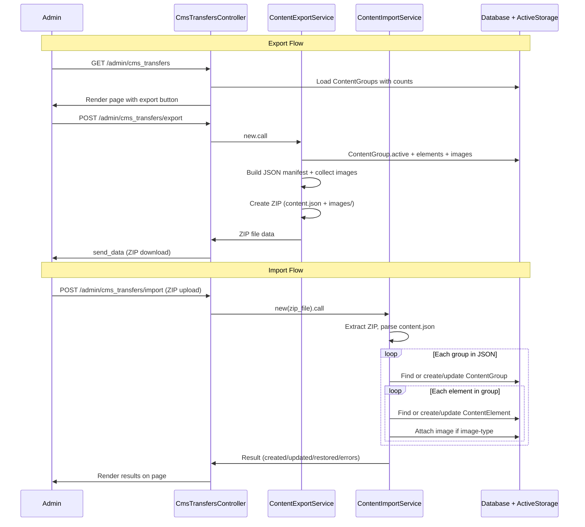

# CMS Content Export/Import

## Overview

Enable admins to export all CMS content (ContentGroups + ContentElements) as a ZIP file from one environment (e.g., local development) and import it into another (e.g., production). The import uses a "match by name, update existing" strategy with soft-delete restoration, and processing is synchronous for instant feedback.

## Problem Statement

Content editors and developers create content groups and elements locally during development. Currently there is no way to transfer this CMS content to production without manually recreating each group and element in the admin panel. This creates friction during deployments and makes it impossible to version-control CMS content alongside code changes.

The engine already has post import/export (markdown + YAML frontmatter via ActiveJob), but CMS content is structured data (groups contain elements) that requires a different format and approach.

## Proposed Solution

### Architecture

```
┌────────────────────────────────────────────────────────────┐
│  Admin CMS Transfer Page                                   │
│  (/railspress/admin/cms_transfers)                         │
│                                                            │
│  ┌─ Export Section ──────────────────────────────────────┐  │
│  │  [Content summary table]                              │  │
│  │  [Export All Content] button → downloads ZIP           │  │
│  └───────────────────────────────────────────────────────┘  │
│                                                            │
│  ┌─ Import Section ──────────────────────────────────────┐  │
│  │  [File upload dropzone]                               │  │
│  │  [Import] button → processes synchronously            │  │
│  │  [Results panel: created/updated/restored/errors]     │  │
│  └───────────────────────────────────────────────────────┘  │
└────────────────────────────────────────────────────────────┘
```



### Key Design Decisions

| Decision | Choice | Rationale |
|----------|--------|-----------|
| Format | ZIP (JSON manifest + images/) | Structured data needs JSON; images need binary files |
| Processing | Synchronous | CMS datasets are small (<100 elements typically); instant feedback |
| Conflict resolution | Match by name, update existing | Dev content is source of truth for deployments |
| Soft-deleted records | Restore if in import file | Import file represents desired state |
| Version history | Export current state only | Production creates its own version history |
| Versioning on import | Normal auto-versioning fires | Import changes tracked like any other edit |
| Images | Included in ZIP | Complete content portability |
| UI | Separate CMS section | Different workflow from post imports; single page with export + import sections |
| author_id | Not exported/imported | IDs are environment-specific; meaningless across environments |
| Metadata | Full (name, description, content_type, position, text_content) | Exact reconstruction of source content |

## Technical Approach

### Prerequisites

#### Unique Index on ContentElement (name, content_group_id)

The import's "find by group + name" strategy requires uniqueness. Currently there is no database-level constraint. Before implementing import/export, add:

1. A migration adding a unique index on `(content_group_id, name)` where `deleted_at IS NULL` (partial unique index)
2. A model validation: `validates :name, uniqueness: { scope: :content_group_id, conditions: -> { active } }`

This ensures the `find_by(name:, content_group_id:)` lookup returns a deterministic single record.

#### JSON Schema

```json
{
  "version": 1,
  "exported_at": "2026-02-07T15:30:00Z",
  "source": "RailsPress CMS",
  "groups": [
    {
      "name": "Homepage",
      "description": "Homepage content elements",
      "elements": [
        {
          "name": "Hero H1",
          "content_type": "text",
          "position": 1,
          "text_content": "Welcome to Our Site"
        },
        {
          "name": "Hero Image",
          "content_type": "image",
          "position": 2,
          "text_content": null,
          "image_path": "images/homepage/hero-image.png"
        }
      ]
    }
  ]
}
```

**Image path convention:** `images/{sanitized_group_name}/{sanitized_element_name}.{ext}` — uses subdirectories to prevent naming collisions when elements in different groups share names.

### Implementation Phases

#### Phase 1: Prerequisite — Unique Index Migration

Add database-level uniqueness for the import lookup strategy.

**Tasks:**

- [x] Create migration adding partial unique index on `(content_group_id, name)` where `deleted_at IS NULL`
- [x] Add model validation `validates :name, uniqueness: { scope: :content_group_id, conditions: -> { active } }`
- [x] Verify existing data has no violations (check in migration)
- [x] Run existing tests to confirm no regressions

**Files:**

```
db/migrate/TIMESTAMP_add_unique_index_to_content_elements.rb   # New
app/models/railspress/content_element.rb                        # Modify
```

**Migration:**

```ruby
# db/migrate/TIMESTAMP_add_unique_index_to_content_elements.rb
class AddUniqueIndexToContentElements < ActiveRecord::Migration[8.1]
  def change
    add_index :railspress_content_elements,
              [:content_group_id, :name],
              unique: true,
              where: "deleted_at IS NULL",
              name: "idx_content_elements_unique_name_per_group"
  end
end
```

**Success criteria:**
- Migration runs cleanly
- Attempting to create two active elements with the same name in the same group raises `ActiveRecord::RecordNotUnique`
- Soft-deleted elements with the same name don't trigger the constraint
- All existing tests pass

---

#### Phase 2: Export Service

Create a service object that builds the ZIP file synchronously.

**Tasks:**

- [x] Create `ContentExportService` in `app/services/railspress/`
- [x] Build JSON manifest from active ContentGroups + active ContentElements
- [x] Collect image attachments from image-type elements into `images/{group}/{element}.{ext}`
- [x] Create ZIP file using `rubyzip` (already in Gemfile from post exports)
- [x] Return ZIP data as a string (for `send_data` in controller)
- [x] Sanitize group/element names for filesystem paths
- [x] Handle edge case: empty database (valid JSON with empty groups array)
- [x] Handle edge case: image-type element with no attached image (skip image, include in JSON with `image_path: null`)

**Files:**

```
app/services/railspress/content_export_service.rb   # New
```

**Service specification:**

```ruby
# app/services/railspress/content_export_service.rb
module Railspress
  class ContentExportService
    Result = Struct.new(:zip_data, :filename, :group_count, :element_count, keyword_init: true)

    def call
      # 1. Build manifest hash
      # 2. Collect images to temp dir
      # 3. Create ZIP (content.json + images/)
      # 4. Return Result with zip_data for send_data
    end

    private

    def build_manifest
      # ContentGroup.active.includes(content_elements: { image_attachment: :blob })
      # Build JSON structure with version: 1, exported_at, groups[]
    end

    def sanitize_path(name)
      # Convert to filesystem-safe: downcase, gsub non-alphanumeric to hyphens
      name.downcase.gsub(/[^a-z0-9]+/, "-").gsub(/^-|-$/, "")
    end

    def image_path_for(group, element)
      # "images/#{sanitize_path(group.name)}/#{sanitize_path(element.name)}.#{ext}"
    end
  end
end
```

**Success criteria:**
- Exports all active groups and their active elements
- Excludes soft-deleted groups and elements
- JSON manifest matches defined schema
- Images stored in `images/{group}/{element}.{ext}` structure
- Empty database produces valid ZIP with `{ "version": 1, "groups": [] }`
- Image-type elements without attachments have `image_path: null`
- No author_id in export

---

#### Phase 3: Import Service

Create a service object that processes an uploaded ZIP synchronously.

**Tasks:**

- [x] Create `ContentImportService` in `app/services/railspress/`
- [x] Extract ZIP to temp directory with path traversal protection
- [x] Parse and validate `content.json` (check version, required fields)
- [x] For each group: `ContentGroup.find_by(name:)` (unscoped — includes soft-deleted)
  - If found and soft-deleted → restore (clear `deleted_at`) + update
  - If found and active → update description
  - If not found → create
- [x] For each element: find by `content_group_id` + `name` (unscoped — includes soft-deleted)
  - If found and soft-deleted → restore + update all fields
  - If found and active → update all fields
  - If not found → create
- [x] Attach images from ZIP for image-type elements
- [x] Track results: created, updated, restored, skipped, errors
- [x] Clean up temp directory in ensure block
- [x] Handle edge cases: missing `content.json`, invalid JSON, missing image files, content_type changes

**Files:**

```
app/services/railspress/content_import_service.rb   # New
```

**Service specification:**

```ruby
# app/services/railspress/content_import_service.rb
module Railspress
  class ContentImportService
    Result = Struct.new(:created, :updated, :restored, :errors, keyword_init: true) do
      def total_processed
        created + updated + restored
      end

      def success?
        errors.empty?
      end
    end

    MAX_ZIP_SIZE = 50.megabytes
    MAX_ENTRIES = 500

    def initialize(zip_file)
      @zip_file = zip_file
      @created = 0
      @updated = 0
      @restored = 0
      @errors = []
    end

    def call
      validate_zip_size!
      extract_and_process
      Result.new(created: @created, updated: @updated, restored: @restored, errors: @errors)
    ensure
      cleanup_temp_dir
    end

    private

    def process_group(group_data)
      # Unscoped find — includes soft-deleted
      group = ContentGroup.find_by(name: group_data["name"])

      if group
        group.restore if group.deleted?
        group.update!(description: group_data["description"])
        # track restored or updated
      else
        group = ContentGroup.create!(name: group_data["name"], description: group_data["description"])
        # track created
      end

      group_data["elements"]&.each { |el| process_element(group, el) }
    rescue => e
      @errors << "Group '#{group_data['name']}': #{e.message}"
    end

    def process_element(group, element_data)
      # Unscoped find within group — includes soft-deleted
      element = ContentElement.unscoped
                  .where(content_group_id: group.id, name: element_data["name"])
                  .first

      attrs = {
        content_type: element_data["content_type"],
        position: element_data["position"],
        text_content: element_data["text_content"]
      }

      if element
        element.restore if element.deleted?
        element.update!(attrs)
        # track restored or updated
      else
        element = group.content_elements.create!(attrs.merge(name: element_data["name"]))
        # track created
      end

      attach_image(element, element_data["image_path"]) if element_data["image_path"]
    rescue => e
      @errors << "Element '#{element_data['name']}' in '#{group.name}': #{e.message}"
    end

    def safe_entry_name?(name)
      # Reject path traversal attempts
      !name.include?("..") && !name.start_with?("/")
    end
  end
end
```

**Conflict resolution matrix:**

| Scenario | Group Action | Element Action |
|----------|-------------|---------------|
| Not found | Create | Create |
| Found, active | Update description | Update all fields |
| Found, soft-deleted | Restore + update | Restore + update |
| Found, soft-deleted group with active elements | Restore group | Elements processed individually |
| Validation failure | Log error, skip group's elements | Log error, continue with next element |
| Image file missing in ZIP | N/A | Create element, log warning |
| content_type changed | N/A | Allow change, update accordingly |

**Security protections:**

- ZIP size limit: 50MB max
- Entry count limit: 500 max
- Path traversal: reject entries containing `..` or starting with `/`
- Skip `__MACOSX` and `.` prefixed entries
- JSON schema validation (check for `version`, `groups` key)

**Success criteria:**
- Creates new groups/elements from import
- Updates existing groups/elements by name match
- Restores soft-deleted groups and elements
- Attaches images from ZIP to image-type elements
- Auto-versioning fires on text_content changes (normal model callbacks)
- Re-importing same ZIP is idempotent (no duplicate records, no unnecessary versions)
- Errors on individual items don't stop processing
- Temp files cleaned up even on failure

---

#### Phase 4: Controller & Routes

Create the controller and routes for the CMS transfer page.

**Tasks:**

- [x] Create `CmsTransfersController` with `show`, `export`, and `import` actions
- [x] Add routes under admin namespace
- [x] `show` loads content groups with counts for the export summary
- [x] `export` calls `ContentExportService` and streams ZIP via `send_data`
- [x] `import` accepts ZIP upload, calls `ContentImportService`, renders results
- [x] Add sidebar navigation link

**Files:**

```
app/controllers/railspress/admin/cms_transfers_controller.rb   # New
config/routes.rb                                                 # Modify
app/views/railspress/admin/shared/_sidebar.html.erb             # Modify
```

**Controller specification:**

```ruby
# app/controllers/railspress/admin/cms_transfers_controller.rb
module Railspress
  module Admin
    class CmsTransfersController < BaseController
      def show
        @groups = ContentGroup.active.includes(:content_elements).order(:name)
        @group_count = @groups.size
        @element_count = ContentElement.active.count
        @image_count = ContentElement.active.where(content_type: :image).count
      end

      def export
        result = ContentExportService.new.call
        send_data result.zip_data,
                  filename: result.filename,
                  type: "application/zip",
                  disposition: "attachment"
      end

      def import
        if params[:file].blank?
          redirect_to admin_cms_transfer_path, alert: "Please select a ZIP file to import."
          return
        end

        @result = ContentImportService.new(params[:file]).call
        @groups = ContentGroup.active.includes(:content_elements).order(:name)
        @group_count = @groups.size
        @element_count = ContentElement.active.count
        @image_count = ContentElement.active.where(content_type: :image).count

        if @result.errors.any?
          flash.now[:alert] = "Import completed with #{@result.errors.size} error(s)."
        else
          flash.now[:notice] = "Import successful! #{@result.total_processed} items processed."
        end

        render :show
      end
    end
  end
end
```

**Routes:**

```ruby
# In config/routes.rb, inside namespace :admin
resource :cms_transfer, only: [:show] do
  post :export, on: :member
  post :import, on: :member
end
```

**Sidebar link** (added after Content Elements link):

```erb
<%= link_to railspress.admin_cms_transfer_path, class: "rp-nav-link #{controller_name == 'cms_transfers' ? 'rp-nav-link--active' : ''}" do %>
  <svg class="rp-nav-icon" viewBox="0 0 24 24" fill="none" stroke="currentColor" stroke-width="2">
    <path d="M12 2v6m0 0l3-3m-3 3L9 5"/>
    <path d="M12 22v-6m0 0l3 3m-3-3l-3 3"/>
    <rect x="3" y="8" width="18" height="8" rx="2"/>
  </svg>
  <span class="rp-nav-text">CMS Transfer</span>
<% end %>
```

**Success criteria:**
- `GET /admin/cms_transfer` shows the transfer page with content summary
- `POST /admin/cms_transfer/export` downloads a ZIP file
- `POST /admin/cms_transfer/import` processes upload and shows results
- Sidebar nav link appears and highlights when active
- Missing file upload shows alert
- Results display on the same page after import

---

#### Phase 5: Views

Create the admin view for the CMS transfer page.

**Tasks:**

- [x] Create `show.html.erb` with export and import sections
- [x] Export section: content summary table + "Export All Content" button
- [x] Import section: file upload area + import button
- [x] Results panel: conditionally rendered after import with created/updated/restored/error counts
- [x] Error details: collapsible list of individual error messages
- [x] Use existing `rp-` CSS classes (cards, tables, buttons, badges)
- [x] Add drag-and-drop for file upload (reuse pattern from post import)

**Files:**

```
app/views/railspress/admin/cms_transfers/show.html.erb   # New
```

**View structure:**

```erb
<%# Page header %>
<div class="rp-page-header">
  <h1 class="rp-page-title">CMS Transfer</h1>
  <div class="rp-page-actions">
    <%= link_to "Content Groups", admin_content_groups_path, class: "rp-btn rp-btn--secondary" %>
  </div>
</div>

<%# Import results (shown after import) %>
<% if @result %>
  <div class="rp-card rp-card--padded" style="margin-bottom: var(--rp-space-lg);">
    <h3>Import Results</h3>
    <%# Badge row: Created X | Updated X | Restored X | Errors X %>
    <%# Error detail list if any %>
  </div>
<% end %>

<%# Export section %>
<div class="rp-card rp-card--padded">
  <h2>Export Content</h2>
  <%# Summary: N groups, N elements, N images %>
  <%# Table of groups with element counts %>
  <%# Export button (POST form) %>
</div>

<%# Import section %>
<div class="rp-card rp-card--padded" style="margin-top: var(--rp-space-lg);">
  <h2>Import Content</h2>
  <%# File upload dropzone (reuse post import pattern) %>
  <%# Import button %>
  <%# Format instructions sidebar %>
</div>
```

**Success criteria:**
- Export section shows group/element/image counts
- Export button downloads ZIP
- Import section has file upload
- Results panel shows after import with accurate counts
- Error details are expandable
- Follows existing admin view patterns (rp-card, rp-table, rp-btn)

---

#### Phase 6: Tests

Add comprehensive tests for the export/import feature.

**Tasks:**

- [ ] Service spec: `ContentExportService` — exports groups, elements, images, handles empty DB
- [ ] Service spec: `ContentImportService` — creates, updates, restores, handles errors
- [ ] Service spec: Import idempotency — re-importing same ZIP produces no duplicates or unnecessary versions
- [ ] Service spec: Import with soft-deleted records — restores groups and elements
- [ ] Service spec: Import with image elements — attaches images from ZIP
- [ ] Service spec: Import security — rejects path traversal, oversized ZIPs
- [ ] Request spec: `GET /admin/cms_transfer` — loads successfully
- [ ] Request spec: `POST /admin/cms_transfer/export` — returns ZIP
- [ ] Request spec: `POST /admin/cms_transfer/import` — processes file and renders results
- [ ] Model spec: ContentElement uniqueness validation within group

**Files:**

```
spec/services/railspress/content_export_service_spec.rb   # New
spec/services/railspress/content_import_service_spec.rb   # New
spec/requests/railspress/admin/cms_transfers_spec.rb       # New
spec/models/railspress/content_element_spec.rb             # Modify (add uniqueness test)
```

**Key test scenarios:**

```ruby
# Export tests
it "exports all active groups and elements as ZIP"
it "excludes soft-deleted groups and elements"
it "includes images in images/{group}/{element}.{ext} structure"
it "produces valid JSON manifest with version 1"
it "handles empty database gracefully"
it "does not include author_id in export"
it "handles image elements without attachments"

# Import tests - creation
it "creates new groups from import"
it "creates new elements within groups"
it "attaches images for image-type elements"

# Import tests - update
it "updates existing groups by name match"
it "updates existing elements by group+name match"
it "fires auto-versioning on text_content changes"
it "does not create version when text_content unchanged"

# Import tests - restore
it "restores soft-deleted groups"
it "restores soft-deleted elements"

# Import tests - idempotency
it "re-importing same ZIP produces no duplicates"

# Import tests - errors
it "collects errors without stopping processing"
it "reports missing image files as warnings"
it "validates JSON schema (missing version key)"
it "rejects ZIP files over 50MB"
it "rejects ZIP entries with path traversal"
it "rejects files without content.json"

# Request tests
it "renders the transfer page successfully"
it "exports content as ZIP download"
it "imports uploaded ZIP and shows results"
it "shows alert when no file selected"
```

**Success criteria:**
- All new tests pass
- All existing tests still pass (no regressions)
- Export + import round-trip produces identical content

---

## Alternative Approaches Considered

### 1. Extend Existing Post Import/Export System

Add `"content"` to `EXPORT_TYPES` / `IMPORT_TYPES` and reuse the existing controllers, models, and async job infrastructure.

**Rejected because:** The existing system is async (ActiveJob), while CMS content processing should be synchronous (small datasets, instant feedback). The post system uses markdown + YAML frontmatter, while CMS content needs structured JSON. The controller patterns are fundamentally different (redirect + poll for status vs. inline results). Forcing CMS into the post system would require significant conditionals and compromise both patterns.

### 2. Rake Tasks Only

`rails railspress:cms:export` and `rails railspress:cms:import` — CLI-only.

**Rejected because:** User chose admin UI. Rake tasks require shell access to production, which many deployment platforms don't easily provide. Admin UI is more accessible for non-technical content editors.

### 3. YAML Format Instead of JSON

Use YAML for the manifest since it's more human-readable.

**Rejected because:** YAML has known security issues with deserialization (though `YAML.safe_load` mitigates this). JSON is simpler, has no ambiguity with multiline strings, and is the standard for data interchange. The content.json file isn't meant to be hand-edited.

### 4. Individual File Per Element (like Post Export)

Each element as its own file with metadata header.

**Rejected because:** CMS content is hierarchical (groups contain elements). A single JSON manifest naturally expresses this hierarchy. Individual files would lose the group-element relationship and require a separate convention for associating elements to groups.

## Acceptance Criteria

### Functional Requirements

- [ ] Export downloads a ZIP containing `content.json` and `images/` directory
- [ ] Export includes all active ContentGroups with descriptions
- [ ] Export includes all active ContentElements with full metadata
- [ ] Export excludes soft-deleted records
- [ ] Export does not include `author_id`
- [ ] Import creates new groups and elements from ZIP
- [ ] Import updates existing groups/elements matched by name
- [ ] Import restores soft-deleted groups/elements found in import file
- [ ] Import auto-versioning fires on text_content changes
- [ ] Import attaches images from ZIP to image-type elements
- [ ] Import shows results: created/updated/restored/error counts
- [ ] Import shows individual error messages
- [ ] Re-importing the same ZIP is idempotent
- [ ] CMS Transfer link appears in admin sidebar

### Non-Functional Requirements

- [ ] Processing is synchronous (no background jobs)
- [ ] ZIP files over 50MB are rejected
- [ ] Path traversal in ZIP entries is blocked
- [ ] ZIP entries with `__MACOSX` or `.` prefix are skipped
- [ ] CMS helper cache is cleared after import
- [ ] Temp files are cleaned up even on failure

### Quality Gates

- [ ] `bundle exec rspec` — all tests pass
- [ ] No RuboCop violations in new/modified files
- [ ] Export + import round-trip produces identical content
- [ ] Manual verification: export from dummy app, import into fresh dummy app

## Dependencies & Prerequisites

| Dependency | Status | Notes |
|-----------|--------|-------|
| ContentGroup model | Complete | Has name (unique), description, SoftDeletable |
| ContentElement model | Complete | Has name, content_type enum, text_content, position, image |
| SoftDeletable concern | Complete | Provides `active` scope, `restore` method |
| Auto-versioning | Complete | Fires after_save on text_content changes |
| rubyzip gem | Complete | Already in Gemfile for post exports |
| Admin UI patterns | Complete | rp-card, rp-table, rp-btn classes |
| Unique index on (group_id, name) | **Needed** | Phase 1 prerequisite migration |

## Risk Analysis & Mitigation

| Risk | Likelihood | Impact | Mitigation |
|------|-----------|--------|------------|
| Duplicate element names in existing data | Low | High | Phase 1 migration validates existing data before adding unique index |
| Large datasets cause request timeout | Low | Medium | 50MB ZIP limit; CMS datasets typically <100 elements |
| Path traversal in uploaded ZIP | Low | Critical | Sanitize all entry names; reject `..` and absolute paths |
| Image attachment bloat on repeated imports | Medium | Low | Rails `has_one_attached` auto-replaces; old blobs cleaned by storage config |
| JSON schema changes in future versions | Low | Medium | `version: 1` field enables forward-compatible schema evolution |
| content_type change breaks element | Low | Medium | Allow changes; validation catches missing required fields |

## Files to Create

| File | Phase | Description |
|------|-------|-------------|
| `db/migrate/TIMESTAMP_add_unique_index_to_content_elements.rb` | 1 | Unique index migration |
| `app/services/railspress/content_export_service.rb` | 2 | Export service |
| `app/services/railspress/content_import_service.rb` | 3 | Import service |
| `app/controllers/railspress/admin/cms_transfers_controller.rb` | 4 | Controller |
| `app/views/railspress/admin/cms_transfers/show.html.erb` | 5 | Transfer page view |
| `spec/services/railspress/content_export_service_spec.rb` | 6 | Export service tests |
| `spec/services/railspress/content_import_service_spec.rb` | 6 | Import service tests |
| `spec/requests/railspress/admin/cms_transfers_spec.rb` | 6 | Request tests |

## Files to Modify

| File | Phase | Description |
|------|-------|-------------|
| `app/models/railspress/content_element.rb` | 1 | Add uniqueness validation |
| `config/routes.rb` | 4 | Add cms_transfer routes |
| `app/views/railspress/admin/shared/_sidebar.html.erb` | 4 | Add nav link |

## Future Considerations

- **Rake task alternative**: Add `rails railspress:cms:export[path]` and `rails railspress:cms:import[path]` for CI/CD pipelines
- **Selective export**: Checkboxes to pick which groups to include
- **Dry run / preview**: Show what would change before committing import
- **Import history**: Track past imports with timestamps and results (reuse Import model)
- **Diff view**: Side-by-side comparison of current vs. imported content before applying
- **Schema versioning**: When JSON schema evolves, add migration logic for older versions
- **Export from admin panel**: Add "Export" button to individual ContentGroup show pages

## Verification Checklist

1. `bundle exec rspec` — all tests pass
2. Start dummy app: `cd spec/dummy && bundle exec rails server -p 3001`
3. Visit admin: `http://127.0.0.1:3001/railspress/admin`
4. Click "CMS Transfer" in sidebar
5. Verify content summary shows correct group/element counts
6. Click "Export All Content" — ZIP downloads
7. Inspect ZIP: `content.json` has correct schema, `images/` has attachments
8. Upload the same ZIP to import section
9. Verify results: all items show as "updated" (idempotent)
10. Delete a content group in admin, then re-import
11. Verify the deleted group is restored with its elements
12. Verify version history shows the import changes

## References

### Internal References

- Post export processor: `app/models/railspress/post_export_processor.rb`
- Post import processor: `app/models/railspress/post_import_processor.rb`
- Export controller: `app/controllers/railspress/admin/exports_controller.rb`
- Import controller: `app/controllers/railspress/admin/imports_controller.rb`
- ContentElement model: `app/models/railspress/content_element.rb`
- ContentGroup model: `app/models/railspress/content_group.rb`
- SoftDeletable concern: `app/models/concerns/railspress/soft_deletable.rb`
- Admin sidebar: `app/views/railspress/admin/shared/_sidebar.html.erb`
- Import view (pattern reference): `app/views/railspress/admin/imports/show.html.erb`
- Export view (pattern reference): `app/views/railspress/admin/exports/show.html.erb`
- Routes: `config/routes.rb`
