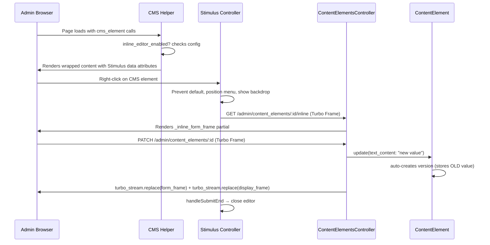

# Inline CMS Content Editing

## Overview

Enable admins to right-click any CMS-powered content on a live page and edit it inline via a floating editor panel. Changes submit through Turbo Frames/Streams and immediately update the displayed content without page reload. Auto-versioning captures every change.

This is Sprint 7 of the Content Element CMS — the backend admin (Sprints 1-6) is complete with models, controllers, views, helper API, and tests. The infrastructure is ~80% in place: routes, controller actions, Turbo Frame support, and importmap registration all exist. What remains is the Stimulus controller, inline form partials, CMS helper wrapper, CSS, configuration, and tests.

## Problem Statement

Content editors currently must navigate to the admin panel (`/railspress/admin/content_elements/:id/edit`) to change any CMS text. This creates friction: they see outdated content on the live page, switch to admin, find the element, edit, save, switch back to verify. Inline editing collapses this to: right-click, edit, save — all without leaving the page.

## Proposed Solution

### Architecture

```
┌─────────────────────────────────────────────────────┐
│  Host App Page (e.g., /pages)                       │
│                                                     │
│  ┌─ <span data-controller="rp--cms-inline-editor">─┐│
│  │  ┌─ Display Turbo Frame ──────────────────────┐ ││
│  │  │  <h1>Welcome to Our Site</h1>              │ ││
│  │  └────────────────────────────────────────────┘ ││
│  │  ┌─ Context Menu (hidden) ────────────────────┐ ││
│  │  │  ┌─ Form Turbo Frame (lazy) ────────────┐  │ ││
│  │  │  │  textarea + Save/Cancel               │  │ ││
│  │  │  └──────────────────────────────────────┘  │ ││
│  │  └────────────────────────────────────────────┘ ││
│  │  ┌─ Backdrop (hidden) ────────────────────────┐ ││
│  │  └────────────────────────────────────────────┘ ││
│  └─────────────────────────────────────────────────┘│
└─────────────────────────────────────────────────────┘
```

1. `cms_element` helper wraps content in a `<span>` with Stimulus controller data attributes
2. Right-click opens a positioned context menu containing a Turbo Frame
3. Turbo Frame lazily loads the inline edit form from `GET /railspress/admin/content_elements/:id/inline`
4. Form submits `PATCH` to the existing update action
5. Controller responds with dual Turbo Streams: one replaces the form frame, one replaces the display frame
6. Auto-versioning fires on save (already implemented in model)

### Key Design Decisions

| Decision | Choice | Rationale |
|----------|--------|-----------|
| Wrapper element | `<span>` | Valid inside `<h1>`, `<p>`, and block elements. Uses `display:contents` for zero layout impact |
| `cms_value` wrapping | No | `cms_value` remains a raw string helper. Only `cms_element` gets inline editing |
| Content update after save | Dual Turbo Streams | Update returns two `turbo_stream.replace` calls: form frame + display frame |
| CSS loading | Injected `<style>` tag | Helper renders styles once per page. No host app configuration needed |
| Duplicate elements | Random suffix on frame IDs | `SecureRandom.hex(4)` appended to each wrapper's frame IDs |
| Multi-editor | One at a time | Opening a new editor closes any existing one via Stimulus outlet/event |
| Admin detection | Configurable proc | `Railspress.configure { |c| c.inline_editing_check = ->(context) { ... } }` |
| Image elements | Excluded from inline wrapping | Only text-type elements get inline editing for MVP |

## Technical Approach

### Architecture



### Implementation Phases

#### Phase 1: Configuration & Helper Foundation

Add the inline editing configuration and update the CMS helper with wrapper methods.

**Tasks:**

- [x] Add `inline_editing_check` to `Railspress::Configuration`
- [x] Add `inline_editor_enabled?` helper method to `CmsHelper`
- [x] Add `inline_wrapper_for` method that wraps content in Stimulus-controlled `<span>`
- [x] Add frame ID helper methods with random suffix support
- [x] Update `cms_element` to call `inline_wrapper_for` when enabled
- [x] Inject `<style>` tag for inline editor CSS (once per page)
- [x] Configure dummy app to enable inline editing

**Files:**

```
lib/railspress.rb                          # Add inline_editing_check config
app/helpers/railspress/cms_helper.rb       # Add wrapper methods
spec/dummy/config/initializers/railspress.rb  # Enable for demo
```

**Success criteria:**
- `cms_element` renders wrapped `<span>` with correct data attributes when admin mode is on
- `cms_element` renders unwrapped content when admin mode is off
- Each wrapper has unique Turbo Frame IDs
- Image elements are not wrapped
- CSS `<style>` tag rendered once per page, not per element

---

#### Phase 2: Stimulus Controller

Port the inline editor Stimulus controller from Innovent Rails, adapted to RailsPress conventions.

**Tasks:**

- [x] Create `cms_inline_editor_controller.js` with targets, values, and actions
- [x] Register in `controllers/index.js` and `index.js`
- [x] Implement right-click handler with viewport-aware positioning
- [x] Implement close handlers (Escape, backdrop click, Cancel button)
- [x] Implement lazy Turbo Frame loading on first open
- [x] Implement one-at-a-time behavior (close others on open)
- [x] Implement `handleSubmitEnd` to close editor after successful save

**Files:**

```
app/javascript/railspress/controllers/cms_inline_editor_controller.js  # New
app/javascript/railspress/controllers/index.js                         # Register
app/javascript/railspress/index.js                                     # Register
```

**Controller specification:**

```javascript
// app/javascript/railspress/controllers/cms_inline_editor_controller.js
import { Controller } from "@hotwired/stimulus"

export default class extends Controller {
  static targets = ["menu", "frame", "backdrop", "display"]

  static values = {
    inlinePath: String,     // GET path for lazy form load
    updatePath: String,     // PATCH path (not used directly, form action handles it)
    frameId: String,        // Display frame ID (for content replacement)
    formFrameId: String,    // Form frame ID (for form replacement)
    elementId: Number,      // Content element database ID
    loaded: { type: Boolean, default: false }
  }

  // Actions:
  // - open (contextmenu event) — position menu, show backdrop, lazy-load frame
  // - close (escape, backdrop click, cancel) — hide menu + backdrop
  // - handleSubmitEnd (turbo:submit-end) — close on success
}
```

**Controller identifier:** `rp--cms-inline-editor`

**Success criteria:**
- Right-click on wrapped element opens positioned editor panel
- Panel stays within viewport bounds
- Escape, backdrop click, and Cancel all close the panel
- Opening a second editor closes the first
- Turbo Frame loads lazily on first open only
- Editor closes after successful form submission

---

#### Phase 3: Inline Form Partials

Create the lightweight form partials that render inside the Turbo Frame.

**Tasks:**

- [x] Create `_inline_form.html.erb` with metadata header, textarea, and action buttons
- [x] Create `_inline_form_frame.html.erb` as Turbo Frame wrapper
- [x] Style the form with vanilla CSS (injected via helper's `<style>` tag)
- [x] Include "Open in admin" link (opens in new tab)
- [x] Show validation errors inline

**Files:**

```
app/views/railspress/admin/content_elements/_inline_form.html.erb        # New
app/views/railspress/admin/content_elements/_inline_form_frame.html.erb  # New
```

**`_inline_form.html.erb` specification:**

```erb
<%# Metadata header: group name, element name, version count %>
<div class="rp-inline-meta">
  <span class="rp-inline-meta__group"><%= content_element.content_group.name %></span>
  <span class="rp-inline-meta__name"><%= content_element.name %></span>
  <span class="rp-inline-meta__version">v<%= content_element.version_count %></span>
</div>

<%# Error display %>
<% if content_element.errors.any? %>
  <div class="rp-inline-errors">
    <% content_element.errors.full_messages.each do |msg| %>
      <p><%= msg %></p>
    <% end %>
  </div>
<% end %>

<%# Form with textarea and buttons %>
<%= form_with(
  model: content_element,
  url: railspress.admin_content_element_path(content_element),
  method: :patch,
  class: "rp-inline-form",
  data: { turbo_frame: local_assigns[:form_frame_id] }
) do |f| %>
  <%= f.text_area :text_content, rows: 4, class: "rp-inline-form__textarea" %>
  <div class="rp-inline-actions">
    <%= f.submit "Save", class: "rp-inline-actions__save" %>
    <button type="button" class="rp-inline-actions__cancel"
            data-action="rp--cms-inline-editor#close">Cancel</button>
    <%= link_to "Open in admin",
        railspress.edit_admin_content_element_path(content_element),
        target: "_blank", class: "rp-inline-actions__admin-link" %>
  </div>
<% end %>
```

**`_inline_form_frame.html.erb` specification:**

```erb
<%= turbo_frame_tag local_assigns[:form_frame_id] || "cms_inline_editor_form_#{content_element.id}" do %>
  <%= render "railspress/admin/content_elements/inline_form",
             content_element: content_element,
             form_frame_id: local_assigns[:form_frame_id] %>
<% end %>
```

**Success criteria:**
- Form shows element metadata (group, name, version)
- Textarea pre-filled with current `text_content`
- Save submits via Turbo Frame
- Cancel closes the editor without submission
- "Open in admin" opens full edit page in new tab
- Validation errors display within the panel

---

#### Phase 4: Controller Updates

Update the controller to handle inline requests with proper frame IDs and dual Turbo Stream responses.

**Tasks:**

- [x] Update `inline` action to accept and pass through `frame_id` and `form_frame_id` params
- [x] Update `update` action to return dual Turbo Streams (form frame + display frame) for inline edits
- [x] Handle the display frame ID being passed as a param from the form
- [x] Ensure `set_content_element` returns a Turbo Frame-safe error for missing elements

**Files:**

```
app/controllers/railspress/admin/content_elements_controller.rb  # Modify
```

**Key change — update action dual streams:**

```ruby
def update
  if @content_element.update(content_element_params)
    Railspress::CmsHelper.clear_cache

    if request.headers["Turbo-Frame"].present?
      display_frame_id = params[:display_frame_id]
      form_frame_id = params[:form_frame_id] || "cms_inline_editor_form_#{@content_element.id}"

      streams = []
      streams << turbo_stream.replace(
        form_frame_id,
        partial: "railspress/admin/content_elements/inline_form_frame",
        locals: { content_element: @content_element, form_frame_id: form_frame_id }
      )
      if display_frame_id.present?
        streams << turbo_stream.replace(
          display_frame_id,
          html: helpers.cms_element_display_frame(@content_element, display_frame_id)
        )
      end
      render turbo_stream: streams
    else
      redirect_to admin_content_element_path(@content_element),
                  notice: "Content element '#{@content_element.name}' updated."
    end
  else
    # ... error handling (existing pattern)
  end
end
```

**Success criteria:**
- Inline update replaces both form and display frames
- Non-inline update still redirects as before
- Frame IDs passed through correctly with random suffixes
- Missing element in Turbo Frame context returns frame-safe error

---

#### Phase 5: Inline Editor CSS

Create the inline editor styles, injected as a `<style>` tag by the helper.

**Tasks:**

- [x] Write all inline editor CSS with `rp-inline-` prefix
- [x] Include in the helper's once-per-page `<style>` injection
- [x] Style: context menu panel, backdrop, form, metadata, buttons, errors
- [x] Use high z-index values (9998 backdrop, 9999 panel) to overlay host app content
- [x] Add hover indicator for editable elements (subtle dashed border)

**CSS specification:**

```css
/* Editable element hover indicator */
[data-controller="rp--cms-inline-editor"]:hover {
  outline: 2px dashed rgba(59, 130, 246, 0.5);
  outline-offset: 2px;
  cursor: context-menu;
}

/* Backdrop */
.rp-inline-backdrop {
  position: fixed;
  inset: 0;
  background: rgba(0, 0, 0, 0.15);
  z-index: 9998;
}

/* Context menu panel */
.rp-inline-menu {
  position: fixed;
  z-index: 9999;
  background: #fff;
  border: 1px solid #e5e7eb;
  border-radius: 8px;
  box-shadow: 0 10px 25px rgba(0, 0, 0, 0.15);
  width: 380px;
  max-height: 80vh;
  overflow-y: auto;
  padding: 1rem;
}

/* Metadata row */
.rp-inline-meta { ... }

/* Form styles */
.rp-inline-form__textarea { ... }

/* Action buttons */
.rp-inline-actions { ... }

/* Error display */
.rp-inline-errors { ... }

/* Hidden utility */
.rp-inline-hidden { display: none !important; }
```

**Success criteria:**
- Panel floats above all host app content
- Backdrop prevents interaction with background
- Hover indicator shows which elements are editable
- Styles are self-contained (no dependency on host app CSS)
- Responsive — panel does not overflow small viewports

---

#### Phase 6: Demo Page & Integration

Update the demo page and verify the full flow end-to-end.

**Tasks:**

- [x] Add instruction banner to demo page ("Right-click any highlighted text to edit inline")
- [x] Configure dummy app initializer to enable inline editing
- [x] Verify all `cms_element` calls on demo page get wrapped
- [x] Verify `cms_value` calls remain unwrapped
- [ ] Test full flow: right-click → edit → save → content updates (manual)

**Files:**

```
spec/dummy/app/views/pages/index.html.erb              # Add banner
spec/dummy/config/initializers/railspress.rb            # Enable inline editing
```

**Success criteria:**
- Demo page shows editable indicators on hover for `cms_element` calls
- Right-click → edit → save flow works end-to-end
- Content updates immediately without page reload
- Version created in admin after inline save
- `cms_value` outputs remain plain text (no wrapper)

---

#### Phase 7: Tests

Add comprehensive tests for the inline editing feature.

**Tasks:**

- [x] Helper specs: wrapper output with admin mode on/off
- [x] Helper specs: unique frame IDs per wrapper instance
- [x] Helper specs: image elements excluded from wrapping
- [x] Helper specs: `<style>` tag rendered once per page
- [x] Request specs: `GET :inline` with Turbo-Frame header
- [x] Request specs: `GET :inline` without Turbo-Frame header (redirects)
- [x] Request specs: `PATCH :update` with Turbo-Frame header (dual streams)
- [x] Request specs: `PATCH :update` with validation errors (inline response)

**Files:**

```
spec/helpers/railspress/cms_helper_spec.rb                        # Extend
spec/requests/railspress/admin/content_elements_spec.rb           # Extend
```

**Helper spec examples:**

```ruby
describe "#cms_element with inline editing" do
  before { allow(helper).to receive(:inline_editor_enabled?).and_return(true) }

  it "wraps content in a span with Stimulus controller" do
    result = helper.cms_element(group: "Headers", name: "Homepage H1") { |v| v }
    expect(result).to include('data-controller="rp--cms-inline-editor"')
    expect(result).to include("<span")
  end

  it "does not wrap when inline editing is disabled" do
    allow(helper).to receive(:inline_editor_enabled?).and_return(false)
    result = helper.cms_element(group: "Headers", name: "Homepage H1") { |v| v }
    expect(result).not_to include("data-controller")
  end

  it "generates unique frame IDs for duplicate elements" do
    result1 = helper.cms_element(group: "Headers", name: "Homepage H1") { |v| v }
    result2 = helper.cms_element(group: "Headers", name: "Homepage H1") { |v| v }
    frame_ids = [result1, result2].map { |r| r[/data-rp--cms-inline-editor-frame-id-value="([^"]+)"/, 1] }
    expect(frame_ids[0]).not_to eq(frame_ids[1])
  end

  it "does not wrap image-type elements" do
    # ... test with image content element fixture
  end

  it "injects style tag only once per page" do
    helper.cms_element(group: "Headers", name: "Homepage H1") { |v| v }
    helper.cms_element(group: "Headers", name: "Tagline") { |v| v }
    # Style tag should appear once, not twice
  end
end
```

**Request spec examples:**

```ruby
describe "GET inline" do
  it "renders inline form frame with Turbo-Frame header" do
    get inline_admin_content_element_path(content_elements(:homepage_h1)),
        headers: { "Turbo-Frame" => "cms_inline_editor_form_#{content_elements(:homepage_h1).id}" }
    expect(response).to have_http_status(:ok)
    expect(response.body).to include("turbo-frame")
    expect(response.body).to include("text_content")
  end

  it "redirects without Turbo-Frame header" do
    get inline_admin_content_element_path(content_elements(:homepage_h1))
    expect(response).to redirect_to(edit_admin_content_element_path(content_elements(:homepage_h1)))
  end
end

describe "PATCH update (inline)" do
  it "returns dual turbo streams for inline update" do
    patch admin_content_element_path(content_elements(:homepage_h1)),
          params: {
            content_element: { text_content: "Updated Title" },
            display_frame_id: "cms_display_abc123",
            form_frame_id: "cms_form_abc123"
          },
          headers: { "Turbo-Frame" => "cms_form_abc123" }
    expect(response.media_type).to eq("text/vnd.turbo-stream.html")
    expect(response.body).to include("cms_form_abc123")
    expect(response.body).to include("cms_display_abc123")
  end
end
```

**Success criteria:**
- All new tests pass
- Existing tests still pass (no regressions)
- Test coverage for admin mode on/off, image exclusion, unique IDs, Turbo Frame handling

## Alternative Approaches Considered

### 1. Turbo Morphing (Page Refresh)
Instead of dual Turbo Streams, use `turbo_stream.action(:morph, ...)` or Turbo's page refresh to re-render the page after save.

**Rejected because:** Morph refreshes the entire page, which loses scroll position, breaks any open UI state, and is slower than targeted frame replacement. It also requires the host app to be Turbo-morphing compatible.

### 2. contenteditable Attribute
Instead of a context menu with a form, make the CMS text directly `contenteditable` and save on blur.

**Rejected because:** `contenteditable` is notoriously inconsistent across browsers, produces unexpected HTML, and doesn't integrate well with textarea-based content (line breaks, formatting). It also provides no clear UX boundary between "viewing" and "editing."

### 3. Admin-Only Overlay Bar
Instead of right-click, show a floating admin bar at the top of the page with a list of editable elements.

**Rejected because:** This requires more screen real estate, breaks the "edit in context" experience, and doesn't scale well when there are many CMS elements on a page.

### 4. Separate CMS Inline Stylesheet
Create `railspress/cms_inline.css` that host apps must include in their layout.

**Rejected because:** Requires host app configuration. The injected `<style>` tag approach is zero-config — the helper handles everything.

## Acceptance Criteria

### Functional Requirements

- [ ] Right-click on `cms_element` content opens inline editor when admin mode is enabled
- [ ] Inline form shows element metadata (group name, element name, version count)
- [ ] Save updates content immediately on the page without reload
- [ ] Version is created automatically on inline save
- [ ] Escape key closes the editor
- [ ] Clicking backdrop closes the editor
- [ ] Cancel button closes the editor
- [ ] "Open in admin" link opens full edit page in new tab
- [ ] Only one editor can be open at a time
- [ ] No editor markup rendered when admin mode is disabled
- [ ] `cms_value` helper remains unwrapped (raw string output)
- [ ] Image-type content elements are excluded from inline wrapping
- [ ] Validation errors display within the inline editor panel

### Non-Functional Requirements

- [ ] `<span>` wrapper with `display:contents` has zero visual impact on page layout
- [ ] Inline editor CSS loads without host app configuration (injected `<style>`)
- [ ] Panel positions within viewport bounds (no overflow off-screen)
- [ ] Each wrapped element has unique Turbo Frame IDs (random suffix)
- [ ] Hover indicator (dashed outline) shows which elements are editable

### Quality Gates

- [ ] `bundle exec rspec` — all tests pass (existing + new)
- [ ] No RuboCop violations in new/modified Ruby files
- [ ] Manual verification on demo page (`http://127.0.0.1:3001/pages`)
- [ ] Right-click → edit → save → verify content updates flow works
- [ ] Verify version created in admin panel after inline save

## Dependencies & Prerequisites

| Dependency | Status | Notes |
|-----------|--------|-------|
| Content Element models (Sprint 1) | Complete | Auto-versioning, soft delete |
| Admin controllers (Sprint 2) | Complete | `inline` action + Turbo Frame handling exist |
| Admin views (Sprint 3) | Complete | Standard CRUD views |
| CMS Helper API (Sprint 4) | Complete | `cms_element`, `cms_value`, chainable API |
| Dashboard integration (Sprint 5) | Complete | Content stats on dashboard |
| Tests (Sprint 6) | Complete | Model, request, helper specs |
| Stimulus infrastructure | Complete | Importmap, registration, window.Stimulus |
| Turbo | Complete | Imported via `@hotwired/turbo-rails` |

## Risk Analysis & Mitigation

| Risk | Likelihood | Impact | Mitigation |
|------|-----------|--------|------------|
| `<span>` wrapper breaks existing page layouts | Low | Medium | Use `display:contents` to make wrapper transparent. Test on demo page. |
| Turbo Frame ID collisions with duplicate elements | Medium | High | Random suffix on each wrapper's frame IDs |
| CSRF token mismatch between host app and engine | Low | High | Turbo automatically includes CSRF token from `<meta>` tags. Test with dummy app. |
| Host app CSS conflicts with inline editor z-index | Medium | Medium | Use very high z-index (9998/9999). Document as a known limitation. |
| Inline editor breaks on mobile (no right-click) | High | Low | Documented as out-of-scope for MVP. Add touch support in future sprint. |
| Concurrent edits on same element (race condition) | Low | Low | Last-write-wins. Version history preserves audit trail. |

## Files to Create

| File | Phase | Description |
|------|-------|-------------|
| `app/javascript/railspress/controllers/cms_inline_editor_controller.js` | 2 | Stimulus controller |
| `app/views/railspress/admin/content_elements/_inline_form.html.erb` | 3 | Inline edit form |
| `app/views/railspress/admin/content_elements/_inline_form_frame.html.erb` | 3 | Turbo Frame wrapper for form |

## Files to Modify

| File | Phase | Description |
|------|-------|-------------|
| `lib/railspress.rb` | 1 | Add `inline_editing_check` config |
| `app/helpers/railspress/cms_helper.rb` | 1 | Add wrapper methods, style injection |
| `app/javascript/railspress/controllers/index.js` | 2 | Register new controller |
| `app/javascript/railspress/index.js` | 2 | Register new controller |
| `app/controllers/railspress/admin/content_elements_controller.rb` | 4 | Dual Turbo Stream responses |
| `spec/dummy/app/views/pages/index.html.erb` | 6 | Add instruction banner |
| `spec/dummy/config/initializers/railspress.rb` | 6 | Enable inline editing |
| `spec/helpers/railspress/cms_helper_spec.rb` | 7 | Inline wrapper tests |
| `spec/requests/railspress/admin/content_elements_spec.rb` | 7 | Inline action + Turbo Stream tests |

## Future Considerations

- **Mobile/touch support**: Add long-press handler and visible edit icon for touch devices
- **Image element inline editing**: File upload widget in the context menu for image-type elements
- **Keyboard accessibility**: Add `aria-role="dialog"`, focus trap, and keyboard-only trigger (e.g., small edit button on focus)
- **Multi-instance update**: When same element appears multiple times on a page, update all instances after save
- **Unsaved changes warning**: Confirm before dismissing editor with unsaved changes
- **Success feedback**: Brief "Saved" toast or green flash after successful inline save
- **Content Security Policy**: Move positioning from inline styles to CSS custom properties for strict CSP environments

## Verification Checklist

1. `bundle exec rspec` — all tests pass
2. Start dummy app: `cd spec/dummy && bundle exec rails server -p 3001`
3. Visit `http://127.0.0.1:3001/pages`
4. Hover over CMS content — dashed outline appears
5. Right-click any CMS text — editor panel opens near cursor
6. Verify metadata shows correct group, element, and version
7. Edit text, click Save — page content updates without reload
8. Press Escape — editor closes
9. Click backdrop — editor closes
10. Right-click, then right-click another element — first editor closes, second opens
11. Click "Open in admin" — new tab opens to full edit page
12. Check admin panel — new version was created
13. Verify `cms_value` outputs have no wrapper markup (view source)
14. Verify non-admin mode renders no editor markup (disable config, reload)

## References

### Internal References

- Sprint 7 plan: `plans/content_element_CMS/SPRINT_7.md`
- Sprint 7 implementation plan: `plans/content_element_CMS/SPRINT_7_PLAN.md`
- CMS Overview: `plans/content_element_CMS/OVERVIEW.md`
- CMS Helper: `app/helpers/railspress/cms_helper.rb`
- Content Elements Controller: `app/controllers/railspress/admin/content_elements_controller.rb:42-82`
- Routes: `config/routes.rb:10-14`
- Stimulus registration: `app/javascript/railspress/controllers/index.js:21-35`
- Importmap: `config/importmap.rb`
- Reference Stimulus controller: `app/javascript/railspress/controllers/focal_point_controller.js`
- Demo page: `spec/dummy/app/views/pages/index.html.erb`
- Engine config: `lib/railspress.rb:7-17`

### Source Reference (Innovent Rails)

- Stimulus controller: `innovent-rails/app/javascript/controllers/cms-inline-editor_controller.js`
- CMS Helper: `innovent-rails/app/helpers/cms_helper.rb`
- Inline CMS Plan: `innovent-rails/.ai/inline_cms_editor_plan.md`
