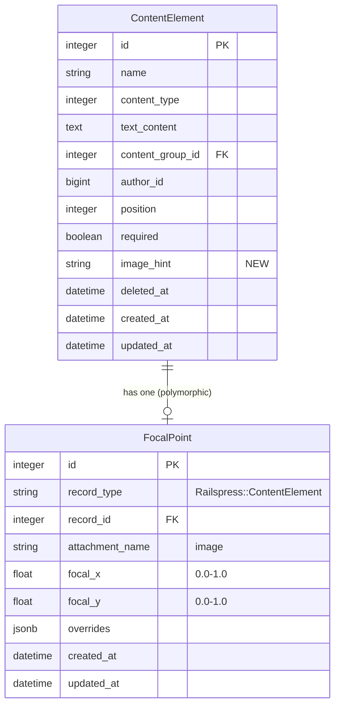

# Image Content Element Upload with Dropzone and Focal Point

## Overview

Image-type content elements currently have no upload UI — the form shows a text_content textarea for all types. This feature adds:

- Dropzone uploader for image-type elements (reusing existing `_dropzone.html.erb` partial)
- Per-element focal point via `HasFocalPoint` concern (polymorphic FocalPoint records)
- `image_hint` string column for developer-specified dimension guidance
- Content type locking after creation (read-only on edit)
- Compact image section with focal point editor on show/edit pages
- Focal point CSS in `cms_element` image output
- Stimulus controller for toggling text vs image fields on new forms

## Key Design Decisions

1. **Focal points use polymorphic FocalPoint records** (existing `HasFocalPoint` concern) — no new columns on content_elements for coordinates
2. **No image variants** — serve originals. Developers use CSS for sizing and can call `image.variant()` directly if needed
3. **Focal point editor on separate page** — consistent with Post pattern, not inline on form
4. **Image elements can exist without attachment** — `cms_element` returns nil for missing images (developer wraps in conditional). No validation requiring image presence
5. **Content type immutable after creation** — model validation prevents changes on update
6. **Image_hint is admin-editable** — shown on form for image-type elements, displayed above dropzone
7. **No image versioning** — auto-versioning only tracks text_content. Image replacements purge the old attachment
8. **Alt text uses element name** — no new column. Developers customize via `cms_element` block form or `html_options`
9. **Focal point resets to center on image replacement** — via existing `HasFocalPoint` `after_commit` callback behavior
10. **Pass `editor_url:` as optional local to `_image_section_compact`** — avoids coupling the partial to ContentElement

## Acceptance Criteria

- [x] Dropzone uploader replaces text_content for image-type elements on new/edit forms
- [x] Focal point per image element via `HasFocalPoint` concern
- [x] `image_hint` string column, editable on form, displayed above dropzone
- [x] `content_type` locked (read-only) after element creation, with model validation
- [x] Compact image section on edit page for elements with attached images
- [x] Focal point editor accessible from compact image section (separate page)
- [x] `cms_element` outputs `` with focal point `object-position` CSS
- [x] Stimulus controller toggles text/image fields on new form
- [x] Export includes focal point data; import restores it
- [x] Route + controller action for content element image editor
- [x] Tests for all behaviors
- [x] Documentation updated

## Files to Modify

### 1. Migration

**New file:** `db/migrate/TIMESTAMP_add_image_hint_to_railspress_content_elements.rb`

```ruby
class AddImageHintToRailspressContentElements < ActiveRecord::Migration[8.1]
  def change
    add_column :railspress_content_elements, :image_hint, :string
  end
end
```

No focal point migration needed — `railspress_focal_points` table already exists and is polymorphic.

### 2. Model: `app/models/railspress/content_element.rb`

**Add HasFocalPoint concern and type immutability:**

```ruby
include Railspress::HasFocalPoint
has_focal_point :image  # adds polymorphic focal point association

validate :content_type_unchanged, on: :update

private

def content_type_unchanged
  if content_type_changed?
    errors.add(:content_type, "cannot be changed after creation")
  end
end
```

Remove the existing `has_one_attached :image` (line 9) — `has_focal_point :image` calls `has_one_attached` internally if not already declared. Actually, check: `has_focal_point` does NOT call `has_one_attached`. It only sets up the focal point association. So keep `has_one_attached :image` and add `has_focal_point :image` after it.

**Permit `image_hint` in controller params.**

### 3. Controller: `app/controllers/railspress/admin/content_elements_controller.rb`

**Add `image_editor` action:**

```ruby
def image_editor
  if params[:compact] == "true"
    render partial: "railspress/admin/shared/image_section_compact",
           locals: {
             record: @content_element,
             attachment_name: :image,
             label: "Element Image",
             editor_url: image_editor_admin_content_element_path(@content_element)
           }
  else
    @content_element.send(:ensure_image_focal_point)
    @content_element.image_focal_point.save! if @content_element.image_focal_point.new_record?
    render "image_editor"
  end
end
```

**Add to `before_action`:** `:image_editor` to the list for `set_content_element`.

**Permit new params:**
```ruby
params.require(:content_element).permit(
  :name, :content_group_id, :content_type, :position,
  :text_content, :image, :required, :image_hint,
  image_focal_point_attributes: [:id, :focal_x, :focal_y]
)
```

### 4. Routes: `config/routes.rb`

Add `image_editor` member route on content_elements (inside the CMS block, line 11-15):

```ruby
resources :content_elements do
  member do
    get :inline
    get :image_editor
  end
end
```

### 5. Partial: `app/views/railspress/admin/shared/_image_section_compact.html.erb`

Add optional `editor_url` local, with fallback to existing Post/Entity logic:

```ruby
<%
  editor_url ||= nil
  unless editor_url
    if record.is_a?(Railspress::Post)
      editor_url = image_editor_admin_post_path(record, attachment: attachment_name)
    else
      entity_type = record.class.railspress_config.route_key
      editor_url = admin_entity_image_editor_path(entity_type: entity_type, id: record.id, attachment: attachment_name)
    end
  end
%>
```

This is backward-compatible — existing callers don't pass `editor_url` and hit the existing logic.

### 6. View: `app/views/railspress/admin/content_elements/image_editor.html.erb`

**New file** — renders the focal point editor for a content element image:

```erb
<% content_for :title, "Edit Image — #{@content_element.name}" %>

<%= render "railspress/admin/shared/image_section_editor",
     record: @content_element,
     attachment_name: :image,
     label: "Element Image",
     compact_url: image_editor_admin_content_element_path(@content_element, compact: true),
     contexts: Railspress.image_contexts %>
```

Need to verify that `_image_section_editor.html.erb` exists and works with the `compact_url` local. The editor partial renders the focal point picker and posts to `focal_points#update` (already polymorphic).

### 7. FocalPointsController: `app/controllers/railspress/admin/focal_points_controller.rb`

The `redirect_to_record` private method needs a branch for ContentElement:

```ruby
def redirect_to_record
  if @record.is_a?(Railspress::Post)
    redirect_to edit_admin_post_path(@record)
  elsif @record.respond_to?(:railspress_config)
    redirect_to edit_admin_entity_path(entity_type: @record.class.railspress_config.route_key, id: @record.id)
  elsif @record.is_a?(Railspress::ContentElement)
    redirect_to edit_admin_content_element_path(@record)
  else
    redirect_to admin_root_path
  end
end
```

Also, the `render_compact_view` method (if it exists) needs to pass `editor_url` for ContentElement records.

### 8. View: `app/views/railspress/admin/content_elements/_form.html.erb`

**Major rewrite** — conditional rendering based on content_type and persisted state:

```erb
<%= form_with model: [:admin, @content_element], class: "rp-form rp-form--narrow",
    data: @content_element.new_record? ? { controller: "railspress--content-element-form" } : {} do |form| %>
  <%= rp_form_errors(@content_element) %>

  <%= rp_string_field(form, :name, primary: true, placeholder: "e.g., Hero H1, Tagline, Footer Text", required: true) %>

  <%= rp_select_field(form, :content_group_id,
        choices: @content_groups.map { |g| [g.name, g.id] },
        include_blank: "Select a group",
        label: "Content Group",
        hint: "Which group does this element belong to?") %>

  <% if @content_element.new_record? %>
    <%# New form: content_type is selectable, Stimulus toggles fields %>
    <%= rp_select_field(form, :content_type,
          choices: Railspress::ContentElement.content_types.keys.map { |t| [t.titleize, t] },
          label: "Content Type",
          hint: "Text for editable text content, Image for uploaded images",
          input_html: { data: { railspress__content_element_form_target: "typeSelect",
                                action: "railspress--content-element-form#toggle" } }) %>

    <%# Text fields (shown when type=text) %>
    <div data-railspress--content-element-form-target="textFields">
      <%= rp_text_field(form, :text_content, rows: 5, placeholder: "Enter the content value...",
            label: "Text Content", hint: "The text value that will be loaded in views") %>
    </div>

    <%# Image fields (shown when type=image) %>
    <div data-railspress--content-element-form-target="imageFields" style="display: none;">
      <%= rp_string_field(form, :image_hint, label: "Image Hint",
            placeholder: "e.g., Recommended: 1920x600, 16:9 landscape",
            hint: "Guidance for admins about recommended image dimensions") %>
      <%= render "railspress/admin/shared/dropzone", form: form, field_name: :image,
            hint: "PNG, JPG, WebP up to 10MB" %>
    </div>
  <% else %>
    <%# Edit form: content_type is locked %>
    <div class="rp-form-group">
      <label class="rp-label">Content Type</label>
      <%= rp_badge(@content_element.content_type.titleize,
            status: @content_element.text? ? :published : :info) %>
      <%= form.hidden_field :content_type %>
    </div>

    <% if @content_element.text? %>
      <%= rp_text_field(form, :text_content, rows: 5, placeholder: "Enter the content value...",
            label: "Text Content", hint: "The text value that will be loaded in views") %>
    <% else %>
      <%= rp_string_field(form, :image_hint, label: "Image Hint",
            placeholder: "e.g., Recommended: 1920x600, 16:9 landscape",
            hint: "Guidance for admins about recommended image dimensions") %>
      <% if @content_element.image.attached? && @content_element.image.blob&.persisted? %>
        <%= render "railspress/admin/shared/image_section_compact",
              record: @content_element, attachment_name: :image,
              label: "Element Image",
              editor_url: image_editor_admin_content_element_path(@content_element) %>
      <% else %>
        <%= render "railspress/admin/shared/dropzone", form: form, field_name: :image,
              prompt: @content_element.image_hint.presence || "Drag image here or click to browse",
              hint: "PNG, JPG, WebP up to 10MB" %>
      <% end %>
    <% end %>
  <% end %>

  <%= rp_integer_field(form, :position, label: "Position",
        hint: "Order within the group (lower numbers first)") %>

  <%= rp_boolean_field(form, :required, label: "Required element",
        hint: "Required elements cannot be deleted. Use for elements your application code depends on.") %>

  <%= rp_form_actions(form, admin_content_elements_path) %>
<% end %>
```

### 9. Stimulus: `app/javascript/railspress/controllers/content_element_form_controller.js`

**New file** — toggles text/image fields on new forms:

```javascript
import { Controller } from "@hotwired/stimulus"

export default class extends Controller {
  static targets = ["typeSelect", "textFields", "imageFields"]

  connect() {
    this.toggle()
  }

  toggle() {
    const isImage = this.typeSelectTarget.value === "image"
    this.textFieldsTarget.style.display = isImage ? "none" : ""
    this.imageFieldsTarget.style.display = isImage ? "" : "none"
  }
}
```

**Register in `app/javascript/railspress/index.js`:**
```javascript
import ContentElementFormController from "./controllers/content_element_form_controller"
// In register function:
application.register("railspress--content-element-form", ContentElementFormController)
```

### 10. View: `app/views/railspress/admin/content_elements/show.html.erb`

Add compact image section for image elements (after metadata card, before content preview):

```erb
<% if @content_element.image? && @content_element.image.attached? %>
  <%= render "railspress/admin/shared/image_section_compact",
        record: @content_element, attachment_name: :image,
        label: "Element Image",
        editor_url: image_editor_admin_content_element_path(@content_element) %>
<% end %>
```

Also add `image_hint` to the metadata card if present:
```erb
<% if @content_element.image? && @content_element.image_hint.present? %>
  <div class="rp-meta-item">
    <span class="rp-meta-label">Image Hint</span>
    <span class="rp-meta-value"><%= @content_element.image_hint %></span>
  </div>
<% end %>
```

### 11. CMS Helper: `app/helpers/railspress/cms_helper.rb`

Update `cms_element` image output to include focal point CSS (line 101-103):

```ruby
if content_element&.image? && content_element&.image&.attached?
  focal_css = content_element.has_focal_point?(:image) ? content_element.focal_point_css(:image) : nil
  img_options = html_options.dup
  if focal_css
    existing_style = img_options[:style].to_s
    img_options[:style] = [existing_style, focal_css].reject(&:blank?).join("; ")
  end
  img_options[:alt] ||= content_element.name
  return image_tag(main_app.url_for(content_element.image), img_options)
end
```

### 12. Export: `app/services/railspress/content_export_service.rb`

Add `image_hint` and focal point data to `serialize_element`:

```ruby
data = {
  "name" => element.name,
  "content_type" => element.content_type,
  "position" => element.position,
  "text_content" => element.text_content,
  "required" => element.required,
  "image_hint" => element.image_hint
}

if element.image? && element.respond_to?(:image_focal_point)
  fp = element.image_focal_point
  if fp&.persisted? && fp.offset_from_center?
    data["focal_point"] = { "x" => fp.focal_x, "y" => fp.focal_y }
  end
end
```

### 13. Import: `app/services/railspress/content_import_service.rb`

Add `image_hint` to attrs and restore focal point:

```ruby
attrs = {
  content_type: element_data["content_type"],
  position: element_data["position"],
  text_content: element_data["text_content"],
  required: element_data.fetch("required", false),
  image_hint: element_data["image_hint"]
}.compact

# After element create/update:
if element_data["focal_point"].is_a?(Hash)
  fp = element.image_focal_point
  fp.update!(
    focal_x: element_data["focal_point"]["x"],
    focal_y: element_data["focal_point"]["y"]
  )
end
```

### 14. Admin Helper: `app/helpers/railspress/admin_helper.rb`

The `rp_select_field` helper may need to support passing `input_html:` options for Stimulus data attributes. Check if it already does — if not, add passthrough for `data:` attributes on the `<select>` element.

### 15. Initializer Template

Update `lib/generators/railspress/install/templates/initializer.rb` to document image support:

```ruby
# === CMS Content Elements ===
# config.enable_cms
#
# Image elements support focal points when focal points are enabled:
# config.enable_focal_points
#
# Customize image contexts for focal point previews:
# config.add_image_context :banner, aspect: [3, 1], label: "Banner", sizes: [1200]
```

### 16. Documentation

Update `docs/INLINE_EDITING.md` or create section in existing CMS docs explaining:
- How to create image-type content elements
- Setting `image_hint` for developer guidance
- Using `cms_element` with images (focal point CSS auto-applied)
- The focal point editor workflow

### 17. Tests

**Model spec** (`spec/models/railspress/content_element_spec.rb`):
- `content_type` cannot be changed after creation
- `has_focal_point` association exists for image elements
- `image_hint` is persisted

**Request spec** (`spec/requests/railspress/admin/content_elements_spec.rb`):
- `GET image_editor` renders for image elements
- `PATCH` with content_type change is rejected
- `POST` with image type and image_hint persists correctly
- `PATCH` with `image_focal_point_attributes` updates focal point

**Helper spec** (`spec/helpers/railspress/cms_helper_spec.rb`):
- `cms_element` for image with focal point includes `object-position` in style
- `cms_element` for image without focal point renders plain ``
- `cms_element` for image with no attachment returns nil

**Service specs**:
- Export includes `focal_point` and `image_hint` in serialized data
- Import restores focal point coordinates and image_hint

## ERD Changes


