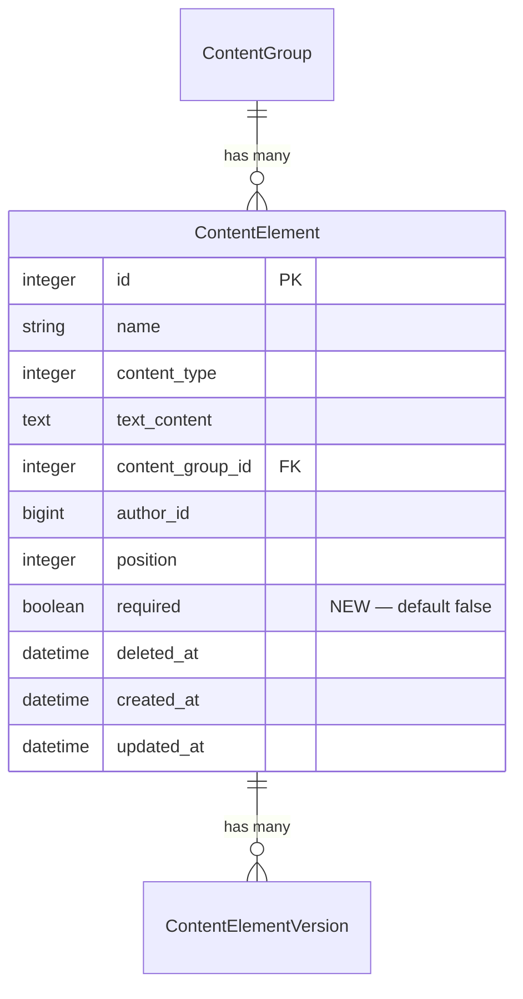

# Add Required Flag to Content Elements

## Overview

Content elements that are referenced in application code (via `cms_value` / `cms_element`) must not be accidentally deleted. This adds a `required` boolean flag to `ContentElement` that:

- Prevents deletion (both UI and model-level)
- Visually distinguishes required elements in all list views (bold name)
- Displays the disabled delete icon with `cursor: not-allowed` and title "Required Element"
- Shows required status on the show page metadata card
- Provides a checkbox with helper text on the edit/new form

## Acceptance Criteria

- [x] `required` boolean column on `railspress_content_elements` (default: `false`)
- [x] Required elements cannot be soft-deleted (model-level guard)
- [x] Controller destroy action returns error flash for required elements
- [x] Delete icon is visually disabled (not removed) for required elements in all table views
- [x] Required element names are bold (`<strong>`) in all table/list views
- [x] Show page metadata card displays "Required" with boolean badge
- [x] New/edit form has "Required" checkbox with hint text
- [x] Export includes `required` flag; import restores it
- [x] Content group deletion is blocked if it contains required elements
- [x] `rp_boolean_field` helper gains `hint:` support
- [x] New `.rp-icon-btn--disabled` CSS class
- [x] Tests for all behaviors

## Files to Modify

### 1. Migration

**New file:** `db/migrate/TIMESTAMP_add_required_to_railspress_content_elements.rb`

```ruby
class AddRequiredToRailspressContentElements < ActiveRecord::Migration[8.0]
  def change
    add_column :railspress_content_elements, :required, :boolean, default: false, null: false
  end
end
```

### 2. Model: `app/models/railspress/content_element.rb`

Add scope and override `soft_delete`:

```ruby
scope :required, -> { where(required: true) }

def soft_delete
  if required?
    errors.add(:base, "Cannot delete a required content element")
    false
  else
    super
  end
end
```

This provides model-level safety so `soft_delete` is guarded regardless of call site (controller, console, group cascade).

### 3. Model: `app/models/railspress/content_group.rb`

Guard `soft_delete` against cascading to required elements:

```ruby
def soft_delete
  if content_elements.active.where(required: true).exists?
    errors.add(:base, "Cannot delete group containing required content elements")
    false
  else
    transaction do
      content_elements.each(&:soft_delete)
      update!(deleted_at: Time.current)
    end
  end
end
```

### 4. Controller: `app/controllers/railspress/admin/content_elements_controller.rb`

**Permit the param** (line 111):
```ruby
params.require(:content_element).permit(:name, :content_group_id, :content_type, :position, :text_content, :image, :required)
```

**Guard the destroy action** (line 84-87) — uses model return value instead of duplicating the check:
```ruby
def destroy
  if @content_element.soft_delete
    redirect_to admin_content_elements_path,
      notice: "Content element '#{@content_element.name}' deleted."
  else
    redirect_to admin_content_elements_path,
      alert: "Cannot delete '#{@content_element.name}' — it is a required element. To delete it, first unmark it as required."
  end
end
```

### 4b. Controller: `app/controllers/railspress/admin/content_groups_controller.rb`

The content groups controller also has a `destroy` action that calls `soft_delete`. Same pattern — use the model return value:

```ruby
def destroy
  if @content_group.soft_delete
    redirect_to admin_content_groups_path,
      notice: "Content group '#{@content_group.name}' deleted."
  else
    redirect_to admin_content_group_path(@content_group),
      alert: "Cannot delete '#{@content_group.name}' — it contains required content elements."
  end
end
```

### 5. Helper: `app/helpers/railspress/admin_helper.rb`

**Add `hint:` support to `rp_boolean_field`** (lines 118-126):

```ruby
def rp_boolean_field(form, name, label: nil, hint: nil, **options)
  label_text = label || name.to_s.humanize

  content_tag(:div, class: "rp-form-group") do
    content_tag(:label, class: "rp-checkbox-label") do
      form.check_box(name, options) + " ".html_safe + label_text
    end +
    (hint ? content_tag(:span, hint, class: "rp-hint") : "".html_safe)
  end
end
```

**Add `disabled:` and `disabled_title:` to `rp_delete_icon`** (lines 405-411):

```ruby
def rp_delete_icon(path, confirm: "Delete this item?", title: "Delete", disabled: false, disabled_title: nil)
  if disabled
    content_tag(:span, class: "rp-icon-btn rp-icon-btn--danger rp-icon-btn--disabled",
                       title: disabled_title || title) do
      rp_icon(:trash)
    end
  else
    button_to path, method: :delete,
      data: { turbo_confirm: confirm },
      class: "rp-icon-btn rp-icon-btn--danger", title: title do
      rp_icon(:trash)
    end
  end
end
```

**Add `delete_disabled:` and `disabled_title:` to `rp_table_action_icons`** (lines 421-423):

```ruby
def rp_table_action_icons(edit_path:, delete_path:, confirm: "Delete this item?",
                          delete_disabled: false, disabled_title: nil)
  rp_edit_icon(edit_path) +
    rp_delete_icon(delete_path, confirm: confirm,
                   disabled: delete_disabled, disabled_title: disabled_title)
end
```

### 6. View: `app/views/railspress/admin/content_elements/index.html.erb`

**Bold name** (line 37):
```erb
<td class="rp-table-primary">
  <%= link_to admin_content_element_path(element), class: "rp-link" do %>
    <% if element.required? %><strong><%= element.name %></strong><% else %><%= element.name %><% end %>
  <% end %>
</td>
```

**Disabled delete** (lines 50-54):
```erb
<%= rp_table_action_icons(
      edit_path: edit_admin_content_element_path(element),
      delete_path: admin_content_element_path(element),
      confirm: "Delete this content element?",
      delete_disabled: element.required?,
      disabled_title: "Required Element"
    ) %>
```

### 7. View: `app/views/railspress/admin/content_groups/show.html.erb`

Same two changes as the content elements index — **bold name** (line 50) and **disabled delete** (lines 57-61).

### 8. View: `app/views/railspress/admin/content_elements/show.html.erb`

Add to metadata card after the "Type" item (after line 20):
```erb
<div class="rp-meta-item">
  <span class="rp-meta-label">Required</span>
  <%= rp_boolean_badge(@content_element.required) %>
</div>
```

### 9. View: `app/views/railspress/admin/content_elements/_form.html.erb`

Add after the position field (after line 19):
```erb
<%= rp_boolean_field(form, :required,
      label: "Required element",
      hint: "Required elements cannot be deleted. Use for elements your application code depends on.") %>
```

### 10. CSS: `app/assets/stylesheets/railspress/admin/buttons.css`

Add after `.rp-icon-btn--danger:hover` (after line 135):

```css
.rp-icon-btn--disabled {
  opacity: 0.35;
  cursor: not-allowed;
}
```

No `pointer-events: none` — the `<span>` (not a form/button) already prevents action, and we need `cursor` and `title` to work on hover.

### 11. Export: `app/services/railspress/content_export_service.rb`

Add `required` to `serialize_element` (line 56-61):

```ruby
data = {
  "name" => element.name,
  "content_type" => element.content_type,
  "position" => element.position,
  "text_content" => element.text_content,
  "required" => element.required
}
```

### 12. Import: `app/services/railspress/content_import_service.rb`

Add `required` to attrs in `process_element` (lines 144-148):

```ruby
attrs = {
  content_type: element_data["content_type"],
  position: element_data["position"],
  text_content: element_data["text_content"],
  required: element_data.fetch("required", false)
}.compact
```

### 13. Fixtures: `spec/fixtures/railspress/content_elements.yml`

Add one new fixture (don't modify existing fixtures — could break unrelated tests):

```yaml
required_element:
  name: site_title
  content_type: 0
  text_content: "My Site"
  content_group: homepage
  required: true
  created_at: <%= Time.current %>
  updated_at: <%= Time.current %>
```

### 14. Tests

**Model spec** (`spec/models/railspress/content_element_spec.rb`):
- `required` defaults to `false`
- `.required` scope returns only required elements
- `soft_delete` returns `false` and adds error when `required?`
- `soft_delete` works normally when not required

**Model spec** (`spec/models/railspress/content_group_spec.rb`):
- `soft_delete` is blocked when group has required elements
- `soft_delete` works when group has no required elements

**Request spec** (`spec/requests/railspress/admin/content_elements_spec.rb`):
- `DELETE` for required element redirects with alert, element still active
- `DELETE` for non-required element works as before
- `POST`/`PATCH` with `required: true` persists the flag

**Request spec** (`spec/requests/railspress/admin/content_groups_spec.rb`):
- `DELETE` for group with required elements redirects with alert, group still active

**Service specs**:
- Export includes `required` key in serialized elements
- Import restores `required` flag on create
- Import preserves `required` flag on update

## ERD Changes



## Design Decisions

1. **Model-level guard on `soft_delete`** — not just controller. Prevents bypassing via console, background jobs, or group cascade.
2. **`<span>` not `<button>`** for disabled delete icon — no form submission possible, cursor and title work naturally.
3. **Block group deletion** when it contains required elements — consistent with "required means it must exist."
4. **`<strong>` for bold names** — semantic HTML, accessible, no extra CSS class needed.
5. **Always show "Required" on show page** (both Yes/No) — better discoverability than conditionally hiding it.
6. **`hint:` added to `rp_boolean_field`** — useful for this feature and reusable for future boolean fields.
