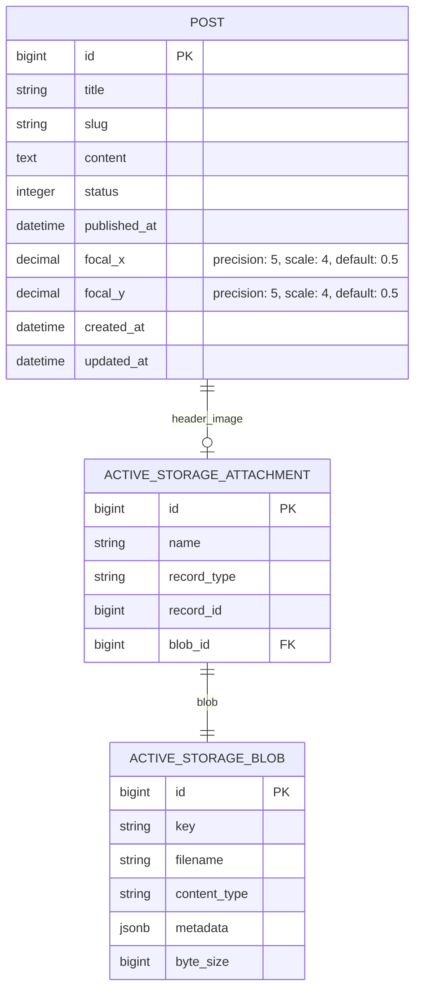

# feat: Smart Image Focal Point System for RailsPress

**Date**: 2025-01-05
**Status**: Draft - Awaiting Review
**Complexity**: Medium-Large
**Prototypes**:
- `.ai/railspress-ui/image-contexts.html` - Focal point picker standalone
- `.ai/railspress-ui/post-edit-with-image.html` - Post form integration
- `.ai/railspress-ui/project-edit-with-image.html` - Entity (Project) form with full modal interactions
**Related**: `.ai/OG_IMAGES.md` (separate feature)

---

## Overview

RailsPress currently uses center-crop (`crop: :centre`) for all image variants. When the same source image needs to display at wildly different aspect ratios (21:9 ultra-wide hero, 16:10 landscape cards, 4:5 portrait masonry), center-crop often cuts off the important subject matter.

This plan proposes a focal point system that lets content editors click on the important part of an image, and RailsPress handles the rest, ensuring that subject stays visible across all display contexts.

---

## Problem Statement

From avi.nyc's CONTENT_IMAGES.md, images appear at these ratios:
- **Hero**: 21:9 ultra-wide (2100x900)
- **Cards**: 16:10 landscape (800x500)
- **Tall**: 4:5 portrait (800x1000)
- **Gallery**: 4:3 (1200x900)
- **Thumbnails**: Various (400x250, 400x300)

A photo of a person standing to the right of frame will:
- Look fine in a 16:10 card (center crops to torso)
- Look terrible in a 21:9 hero (person cropped off right edge)
- Look acceptable in 4:5 tall (center captures most of person)

The current workarounds are:
1. "Keep focal points centered" (limits creative photography)
2. Upload separate images per context (tedious, more storage)
3. Accept poor crops (bad UX)

---

## Proposed Solutions

### Option 1: CSS object-position (Simplest) - RECOMMENDED FOR MVP

**Philosophy**: Store a single focal point (x, y), render with CSS `object-position`. No server-side regeneration.

**How it works**:
1. Editor uploads image
2. Editor clicks on the subject (visual picker)
3. System stores `focal_x: 0.35, focal_y: 0.70` (normalized 0-1)
4. Views render: ``
5. CSS `object-fit: cover` handles the cropping, focal point determines anchor

**Pros**:
- Zero processing overhead
- Immediate effect (no variant regeneration)
- Works with existing ActiveStorage variants
- Simple data model (2 decimal columns)

**Cons**:
- CSS-only, no server-side optimization for file size
- Requires browser support for `object-position` (all modern browsers)
- May not be pixel-perfect at extreme aspect ratios

**Code Sketch**:

```ruby
# app/models/railspress/post.rb
class Post < ApplicationRecord
  # Add columns: focal_x:decimal, focal_y:decimal (precision: 5, scale: 4)
  # Default: 0.5, 0.5 (center)

  def focal_point_style
    return "" unless focal_x.present?
    "object-position: #{(focal_x * 100).round(2)}% #{(focal_y * 100).round(2)}%"
  end
end
```

```erb
<%# app/views/shared/_hero_image.html.erb %>
<%= image_tag post.header_image.variant(:hero),
      alt: post.title,
      class: "w-full h-full object-cover",
      style: post.focal_point_style %>
```

---

### Option 2: CSS + Server Cropping (Balanced)

**Philosophy**: Use CSS for immediate display, generate optimized server variants in background for best quality.

**How it works**:
1. Same focal point storage as Option 1
2. CSS object-position for immediate display
3. Background job calculates crop coordinates from focal point
4. Generates focal-aware variants using `image.crop(left, top, width, height)`
5. Subsequent loads use pre-cropped variants (smaller, optimized)

**Pros**:
- Best of both worlds: instant CSS preview + optimized delivery
- Smaller file sizes (cropped images are smaller)
- Better quality (server crop + resize vs browser crop)

**Cons**:
- More complex (background jobs, cache invalidation)
- Regeneration when focal point changes
- Higher storage (more variant files)

**Code Sketch**:

```ruby
# app/models/concerns/railspress/focal_cropping.rb
module Railspress::FocalCropping
  extend ActiveSupport::Concern

  CONTEXTS = {
    hero: { aspect: [21, 9], sizes: [[2100, 900], [1680, 720]] },
    card: { aspect: [16, 10], sizes: [[1600, 1000], [800, 500]] },
    tall: { aspect: [4, 5], sizes: [[800, 1000]] }
  }.freeze

  def focal_variant(context:, size: :default)
    return header_image.variant(context) unless has_focal_point?

    crop_params = calculate_focal_crop(context, size)
    header_image.variant(
      crop: crop_params,
      resize_to_limit: CONTEXTS[context][:sizes].first
    )
  end

  private

  def calculate_focal_crop(context, size)
    aspect = CONTEXTS[context][:aspect]
    # ... algorithm to center crop around focal point
    [left, top, width, height]
  end
end
```

---

### Option 3: Per-Context Crop Regions (Most Flexible)

**Philosophy**: Let editors define separate crop regions for each display context, like Sanity's hotspot + crop system.

**How it works**:
1. Editor uploads image
2. Editor sees preview panels for hero, card, tall
3. Editor can set a different focal point OR drag a crop region per context
4. System stores JSON: `{ hero: { x: 0.3, y: 0.5 }, card: { x: 0.5, y: 0.5 }, tall: { x: 0.4, y: 0.6 } }`
5. Each context renders with its own focal point

**Pros**:
- Maximum control for art direction
- Perfect crops for every context
- Future-proof for new contexts

**Cons**:
- Complex UI (3+ pickers per image)
- More cognitive load for editors
- Data model complexity (JSON or multiple columns)
- Overkill for most use cases

**Recommendation**: Defer to future sprint if user research shows need.

---

## Recommended Approach

**Option 1 (CSS object-position) for MVP**, with architecture that allows Option 2 as opt-in enhancement later.

Rationale:
1. **Simplicity**: 2 columns, 1 picker, CSS rendering
2. **Speed to ship**: Can implement in 1-2 sprints
3. **Low risk**: No variant regeneration complexity
4. **Good enough**: CSS object-position handles 90% of use cases well
5. **Upgradeable**: Same data model works for Option 2 later

---

## Customization Model

**Key insight from review**: The system must be configurable at multiple levels, not hardcoded to avi.nyc's aspect ratios.

### Layered Configuration

```
Site Config (defaults for all entities)
    ↓
Entity Config (overrides per model type)
    ↓
Field Config (overrides per image field on a model)
    ↓
Instance Config (overrides per actual uploaded image)
```

### Site-Level Configuration

```ruby
# config/initializers/railspress.rb
Railspress.configure do |config|
  # Define available contexts and their aspect ratios
  config.image_contexts = {
    hero:  { aspect: [16, 9], sizes: [1920, 1280, 960] },
    card:  { aspect: [4, 3], sizes: [800, 400] },
    thumb: { aspect: [1, 1], sizes: [200] }
  }
end
```

### Entity-Level Override

```ruby
# app/models/project.rb
class Project < ApplicationRecord
  include Railspress::Entity

  railspress_image :screenshot,
    contexts: {
      hero: [21, 9],              # Override: projects use ultra-wide heroes
      portfolio_grid: [3, 2]      # Custom: project-specific context
    },
    allow_custom_uploads: true    # Allow uploading separate image per context
end
```

### Per-Image Options (Admin UI)

For each image, the editor can choose per-context:
1. **Use focal point** (default) - System crops around the focal point
2. **Custom crop** - Editor drags a crop region for this specific context
3. **Upload custom** - Editor uploads a separate image optimized for this context

This is demonstrated in the prototype UI: `.ai/railspress-ui/image-contexts.html`

---

## Technical Specification

### Database Schema

```ruby
# db/migrate/XXXXXX_add_focal_point_to_railspress_posts.rb
class AddFocalPointToRailspressPosts < ActiveRecord::Migration[8.0]
  def change
    add_column :railspress_posts, :focal_x, :decimal, precision: 5, scale: 4, default: 0.5
    add_column :railspress_posts, :focal_y, :decimal, precision: 5, scale: 4, default: 0.5
  end
end
```

For entities, the same pattern applies to any model with `has_one_attached :image`:

```ruby
# In host app migration for entities with images
add_column :projects, :image_focal_x, :decimal, precision: 5, scale: 4, default: 0.5
add_column :projects, :image_focal_y, :decimal, precision: 5, scale: 4, default: 0.5
```

### Model Concern

```ruby
# lib/railspress/has_focal_point.rb
module Railspress
  module HasFocalPoint
    extend ActiveSupport::Concern

    included do
      validates :focal_x, :focal_y,
                numericality: {
                  greater_than_or_equal_to: 0,
                  less_than_or_equal_to: 1
                },
                allow_nil: true
    end

    def focal_point
      { x: focal_x || 0.5, y: focal_y || 0.5 }
    end

    def focal_point_css
      fp = focal_point
      "object-position: #{(fp[:x] * 100).round(2)}% #{(fp[:y] * 100).round(2)}%"
    end

    def has_focal_point?
      focal_x.present? && (focal_x != 0.5 || focal_y != 0.5)
    end

    def reset_focal_point!
      update!(focal_x: 0.5, focal_y: 0.5)
    end
  end
end
```

### View Helper

```ruby
# app/helpers/railspress/image_helper.rb
module Railspress
  module ImageHelper
    # Renders an image with focal point positioning
    #
    # @param record [ActiveRecord::Base] Record with focal point attributes
    # @param attachment [Symbol] Name of the attachment (e.g., :header_image)
    # @param variant [Symbol] Named variant (e.g., :hero, :card)
    # @param options [Hash] Additional HTML options
    # @return [String] HTML img tag with focal point styling
    #
    # @example Basic usage
    #   <%= rp_focal_image(@post, :header_image, :hero) %>
    #
    # @example With additional classes
    #   <%= rp_focal_image(@post, :header_image, :card, class: "rounded-lg") %>
    #
    def rp_focal_image(record, attachment, variant = nil, **options)
      image = record.public_send(attachment)
      return "" unless image.attached?

      # Merge focal point style with any existing style
      style = options.delete(:style) || ""
      if record.respond_to?(:focal_point_css)
        style = "#{record.focal_point_css}; #{style}".strip
      end

      # Ensure object-fit: cover is applied
      css_class = "object-cover #{options.delete(:class)}".strip

      source = variant ? image.variant(variant) : image

      image_tag(source, **options, class: css_class, style: style.presence)
    end
  end
end
```

### Admin UI - Focal Point Picker

```html
<!-- app/views/railspress/admin/shared/_focal_point_picker.html.erb -->
<div class="rp-focal-picker"
     data-controller="focal-point"
     data-focal-point-x-value="<%= record.focal_x || 0.5 %>"
     data-focal-point-y-value="<%= record.focal_y || 0.5 %>">

  <div class="rp-focal-picker__source">
    <div class="rp-focal-picker__image-container" data-focal-point-target="container">
      <%= image_tag record.public_send(attachment),
            data: { focal_point_target: "image", action: "click->focal-point#pick" } %>
      <div class="rp-focal-picker__crosshair" data-focal-point-target="crosshair"></div>
    </div>
    <p class="rp-form-hint">Click on the most important part of the image</p>
  </div>

  <div class="rp-focal-picker__previews" data-focal-point-target="previews">
    <div class="rp-focal-picker__preview rp-focal-picker__preview--hero">
      <span class="rp-label">Hero (21:9)</span>
      <div class="aspect-[21/9] overflow-hidden">
        <%= image_tag record.public_send(attachment),
              class: "w-full h-full object-cover",
              data: { focal_point_target: "preview" } %>
      </div>
    </div>
    <div class="rp-focal-picker__preview rp-focal-picker__preview--card">
      <span class="rp-label">Card (16:10)</span>
      <div class="aspect-[16/10] overflow-hidden">
        <%= image_tag record.public_send(attachment),
              class: "w-full h-full object-cover",
              data: { focal_point_target: "preview" } %>
      </div>
    </div>
    <div class="rp-focal-picker__preview rp-focal-picker__preview--tall">
      <span class="rp-label">Tall (4:5)</span>
      <div class="aspect-[4/5] overflow-hidden">
        <%= image_tag record.public_send(attachment),
              class: "w-full h-full object-cover",
              data: { focal_point_target: "preview" } %>
      </div>
    </div>
  </div>

  <!-- Hidden inputs for form submission -->
  <%= hidden_field_tag "#{form_field_prefix}[focal_x]", record.focal_x, data: { focal_point_target: "xInput" } %>
  <%= hidden_field_tag "#{form_field_prefix}[focal_y]", record.focal_y, data: { focal_point_target: "yInput" } %>

  <button type="button" class="rp-btn rp-btn--outline rp-btn--sm" data-action="focal-point#reset">
    Reset to Center
  </button>
</div>
```

### Stimulus Controller

```javascript
// app/javascript/controllers/focal_point_controller.js
import { Controller } from "@hotwired/stimulus"

export default class extends Controller {
  static targets = ["container", "image", "crosshair", "preview", "xInput", "yInput"]
  static values = { x: Number, y: Number }

  connect() {
    this.updateCrosshair()
    this.updatePreviews()
  }

  pick(event) {
    const rect = this.imageTarget.getBoundingClientRect()
    const x = (event.clientX - rect.left) / rect.width
    const y = (event.clientY - rect.top) / rect.height

    // Clamp to 0-1 range
    this.xValue = Math.max(0, Math.min(1, x))
    this.yValue = Math.max(0, Math.min(1, y))

    this.updateInputs()
    this.updateCrosshair()
    this.updatePreviews()
  }

  reset() {
    this.xValue = 0.5
    this.yValue = 0.5
    this.updateInputs()
    this.updateCrosshair()
    this.updatePreviews()
  }

  updateInputs() {
    this.xInputTarget.value = this.xValue.toFixed(4)
    this.yInputTarget.value = this.yValue.toFixed(4)
  }

  updateCrosshair() {
    this.crosshairTarget.style.left = `${this.xValue * 100}%`
    this.crosshairTarget.style.top = `${this.yValue * 100}%`
  }

  updatePreviews() {
    const position = `${this.xValue * 100}% ${this.yValue * 100}%`
    this.previewTargets.forEach(preview => {
      preview.style.objectPosition = position
    })
  }
}
```

### CSS for Picker

```css
/* app/assets/stylesheets/railspress/components/_focal_point_picker.css */

.rp-focal-picker {
  display: grid;
  gap: var(--rp-space-4);
}

.rp-focal-picker__image-container {
  position: relative;
  cursor: crosshair;
  max-width: 600px;
  border: 1px solid var(--rp-color-border);
  border-radius: var(--rp-radius-md);
  overflow: hidden;
}

.rp-focal-picker__image-container img {
  display: block;
  width: 100%;
  height: auto;
}

.rp-focal-picker__crosshair {
  position: absolute;
  width: 24px;
  height: 24px;
  margin-left: -12px;
  margin-top: -12px;
  border: 2px solid white;
  border-radius: 50%;
  box-shadow: 0 0 0 2px rgba(0,0,0,0.5), inset 0 0 0 2px rgba(0,0,0,0.3);
  pointer-events: none;
  transition: left 0.1s, top 0.1s;
}

.rp-focal-picker__crosshair::before,
.rp-focal-picker__crosshair::after {
  content: "";
  position: absolute;
  background: white;
  box-shadow: 0 0 2px rgba(0,0,0,0.5);
}

.rp-focal-picker__crosshair::before {
  width: 2px;
  height: 12px;
  left: 50%;
  top: 50%;
  transform: translate(-50%, -50%);
}

.rp-focal-picker__crosshair::after {
  width: 12px;
  height: 2px;
  left: 50%;
  top: 50%;
  transform: translate(-50%, -50%);
}

.rp-focal-picker__previews {
  display: grid;
  grid-template-columns: repeat(auto-fit, minmax(150px, 1fr));
  gap: var(--rp-space-3);
}

.rp-focal-picker__preview {
  display: flex;
  flex-direction: column;
  gap: var(--rp-space-1);
}

.rp-focal-picker__preview > div {
  background: var(--rp-color-surface-secondary);
  border-radius: var(--rp-radius-sm);
}

.rp-focal-picker__preview img {
  transition: object-position 0.1s ease-out;
}
```

---

## Entity System Integration

### Field Declaration

```ruby
# lib/railspress/entity.rb additions
def add_field(name, options = {})
  explicit_type = options[:as]

  # Handle attachment_with_focal_point type
  if explicit_type == :attachment_with_focal_point
    @field_definitions[name.to_sym] = {
      type: :attachment,
      focal_point: true,
      options: options.except(:as)
    }
    # Register focal point fields too
    @field_definitions[:"#{name}_focal_x"] = { type: :hidden, focal_point_field: true }
    @field_definitions[:"#{name}_focal_y"] = { type: :hidden, focal_point_field: true }
  else
    # existing logic
  end
end
```

### Entity Usage

```ruby
# In host app
class Project < ApplicationRecord
  include Railspress::Entity
  include Railspress::HasFocalPoint

  has_one_attached :image

  railspress_fields :title, :description
  railspress_fields :image, as: :attachment_with_focal_point

  # OR simpler approach - just declare the columns exist
  # railspress_fields :image, as: :attachment
  # railspress_fields :image_focal_x, :image_focal_y # auto-detected as decimals
end
```

---

## Configuration

```ruby
# config/initializers/railspress.rb
Railspress.configure do |config|
  # Enable focal point feature (default: true)
  config.focal_point_enabled = true

  # Define preview contexts shown in admin picker
  # Default contexts match common use cases
  config.focal_point_contexts = {
    hero: { aspect: [21, 9], label: "Hero" },
    card: { aspect: [16, 10], label: "Card" },
    tall: { aspect: [4, 5], label: "Tall" }
  }

  # Host apps can add/override contexts
  # config.focal_point_contexts[:square] = { aspect: [1, 1], label: "Square" }
  # config.focal_point_contexts[:story] = { aspect: [9, 16], label: "Story" }
end
```

---

## Active Storage Integration

### How Focal Points Work with Variants

RailsPress will **not change** how ActiveStorage variants are defined. Your existing variant configurations remain the same:

```ruby
# Your current variant setup (unchanged)
has_one_attached :image do |attachable|
  attachable.variant :hero, resize_to_fill: [2100, 900, { crop: :centre }]
  attachable.variant :card, resize_to_fill: [800, 500, { crop: :centre }]
  attachable.variant :tall, resize_to_fill: [800, 1000, { crop: :centre }]
end
```

The focal point is applied at **display time via CSS**, not at variant generation time:

```erb
<%# ActiveStorage still generates center-cropped variants %>
<%# CSS object-position shifts the visible portion to the focal point %>
<%= image_tag @project.image.variant(:hero),
      class: "object-cover w-full h-full",
      style: @project.focal_point_css %>
```

**Why this approach?**
1. **No regeneration needed** - Change focal point, see results instantly
2. **No extra storage** - Same variant files serve all focal points
3. **CDN-friendly** - Variants are cached once, CSS handles the rest
4. **Simpler migration** - Existing variants continue working

### Auto-Detection with libvips (AI Feature)

libvips includes attention detection that can suggest a focal point:

```ruby
# lib/railspress/focal_point_detector.rb
module Railspress
  class FocalPointDetector
    # Uses libvips smartcrop attention detection
    # Returns { x: 0.35, y: 0.45 } - normalized coordinates
    def self.detect(blob)
      require 'vips'

      blob.open do |file|
        image = Vips::Image.new_from_file(file.path, access: :sequential)

        # smartcrop with attention returns the most "interesting" crop region
        # We use the center of that region as the focal point
        x, y, _w, _h = image.smartcrop_attention(100, 100)

        # Normalize to 0-1 range
        {
          x: (x + 50.0) / image.width,
          y: (y + 50.0) / image.height
        }
      end
    rescue => e
      Rails.logger.warn "Focal point detection failed: #{e.message}"
      { x: 0.5, y: 0.5 } # Fall back to center
    end
  end
end
```

**Admin UI Integration:**
```javascript
// When "Auto-detect (AI)" button is clicked:
async autoDetect() {
  const response = await fetch(`/railspress/admin/images/${this.blobId}/detect_focal_point`)
  const { x, y } = await response.json()

  this.xValue = x
  this.yValue = y
  this.updateUI()

  // Show feedback
  this.showToast('AI detected focal point based on image content')
}
```

**Note:** This is opt-in. Editors always have final say with manual override.

### Per-Context Overrides Data Model

When editors use Custom Crop or Upload Custom for specific contexts, we store this as JSON:

```ruby
# Add to migration
add_column :railspress_posts, :image_overrides, :jsonb, default: {}

# Example stored value:
{
  "hero": { "type": "focal" },                    # Uses global focal point
  "card": { "type": "crop", "x": 0.2, "y": 0.1, "w": 0.8, "h": 0.6 },  # Custom crop region
  "thumb": { "type": "upload", "blob_id": "abc123" }  # Separate uploaded image
}
```

**Rendering logic:**
```ruby
# app/helpers/railspress/image_helper.rb
def rp_context_image(record, attachment, context, **options)
  override = record.image_overrides.dig(context.to_s)

  case override&.dig("type")
  when "upload"
    # Use the uploaded custom image for this context
    blob = ActiveStorage::Blob.find_by(id: override["blob_id"])
    return image_tag(blob, **options) if blob
  when "crop"
    # Use custom crop region (requires server-side variant)
    # For MVP, we use CSS clip-path instead
    crop_style = "clip-path: inset(#{override['y']*100}% #{(1-override['x']-override['w'])*100}% #{(1-override['y']-override['h'])*100}% #{override['x']*100}%);"
    return image_tag(record.public_send(attachment).variant(context),
                     style: crop_style, **options)
  else
    # Default: use global focal point with CSS object-position
    rp_focal_image(record, attachment, context, **options)
  end
end
```

---

## Migration Path

### For New Installations

Focal point fields included in default migrations. Works out of the box.

### For Existing Installations

1. Run migration to add `focal_x`, `focal_y` columns (defaults to 0.5)
2. All existing images display as before (center crop, 0.5/0.5)
3. Editors can optionally set focal points going forward
4. No breaking changes

### Bulk Update UI (Nice-to-Have)

Posts index shows filter: "Images without focal point"
Quick-edit modal allows setting focal point without full page reload.

---

## Acceptance Criteria

### Core Functionality
- [ ] Editor can upload image and set focal point with single click
- [ ] Focal point persists on save and reloads correctly on edit
- [ ] Image displays correctly with focal point in hero (21:9), card (16:10), and tall (4:5) contexts
- [ ] Default focal point (center) applied when not set
- [ ] Reset button returns focal point to center

### Admin UI
- [ ] Visual picker shows image with crosshair indicator
- [ ] Live preview panels update as focal point changes
- [ ] Works on desktop browsers (Chrome, Firefox, Safari, Edge)
- [ ] Picker is keyboard accessible (arrow keys, Enter to confirm)
- [ ] Mobile touch events work on iOS Safari and Chrome Android

### Integration
- [ ] Works with Railspress::Post model
- [ ] Works with Entity system for host app models
- [ ] Helper `rp_focal_image` renders correct CSS
- [ ] Existing images without focal point continue to work (center default)

### Performance
- [ ] No additional HTTP requests for CSS-only rendering
- [ ] Picker JS is < 5KB gzipped
- [ ] No visible layout shift on image load

---

## Files to Create/Modify

### New Files
- `lib/railspress/has_focal_point.rb` - Model concern
- `app/helpers/railspress/image_helper.rb` - View helper
- `app/views/railspress/admin/shared/_focal_point_picker.html.erb` - Picker partial
- `app/javascript/controllers/focal_point_controller.js` - Stimulus controller
- `app/assets/stylesheets/railspress/components/_focal_point_picker.css` - Picker styles
- `db/migrate/XXXXXX_add_focal_point_to_railspress_posts.rb` - Migration

### Modified Files
- `app/models/railspress/post.rb` - Include HasFocalPoint concern
- `app/views/railspress/admin/posts/_form.html.erb` - Add picker to form
- `lib/railspress/entity.rb` - Support :attachment_with_focal_point type (optional)
- `app/helpers/railspress/admin_helper.rb` - Add `rp_attachment_field` focal point option
- `lib/railspress.rb` - Add configuration options

---

## Implementation Phases

### Phase 1: Foundation (3-5 days)
- [ ] Add `focal_x`, `focal_y` columns to posts
- [ ] Create `HasFocalPoint` concern with validation and helpers
- [ ] Create `rp_focal_image` view helper
- [ ] Basic tests for focal point CSS generation

### Phase 2: Admin Picker UI (3-5 days)
- [ ] Stimulus controller for click-to-set
- [ ] Picker partial with crosshair and previews
- [ ] CSS styling for picker
- [ ] Integrate into post edit form
- [ ] Keyboard accessibility

### Phase 3: Entity Integration (2-3 days)
- [ ] Update Entity system to support focal point fields
- [ ] Generator updates for new entities
- [ ] Documentation for host app usage

### Phase 4: Polish (2-3 days)
- [ ] Mobile touch event handling
- [ ] Bulk editing UI (filter + quick-edit)
- [ ] User documentation / help text
- [ ] Cross-browser testing

---

## Open Questions

1. **Should ActionText embedded images support focal points?**
   - Recommendation: No for MVP. Featured/header image only.

2. **Should focal point be stored on blob metadata or model columns?**
   - Recommendation: Model columns for simpler querying and form binding.

3. **Do we need separate focal point columns per attachment for multi-image entities?**
   - Recommendation: Yes, use naming convention `{attachment}_focal_x`, `{attachment}_focal_y`

4. **Should we include auto-detection of focal point using libvips attention/entropy?**
   - Recommendation: Nice-to-have for future. User can always override.

---

## ERD



---

## References

### Internal
- `/Users/avi/Development/code/avinyc/avi.nyc/avinyc-rails/docs/CONTENT_IMAGES.md` - Aspect ratio requirements
- `/Users/avi/Development/code/avinyc/avi.nyc/avinyc-rails/app/models/project.rb` - Current variant definitions
- `/Users/avi/Development/code/RailsPress/railspress-engine/railspress/lib/railspress/entity.rb` - Entity system

### External
- [Sanity Image Hotspot](https://www.sanity.io/docs/apis-and-sdks/presenting-images) - Best-in-class CMS implementation
- [WordPress FocalPointPicker](https://developer.wordpress.org/block-editor/reference-guides/components/focal-point-picker/) - UI component pattern
- [Pure CSS Focal Points](https://henry.codes/writing/pure-css-focal-points/) - CSS object-position technique
- [Wagtail Focal Point Model](https://github.com/wagtail/wagtail/blob/main/wagtail/images/models.py) - Django implementation
- [imgix Focal Point API](https://docs.imgix.com/en-US/apis/rendering/focal-point-crop) - Server-side cropping

### Rails/Ruby
- [image_processing gem](https://github.com/janko/image_processing) - Variant processing
- [ActiveStorage Variants](https://edgeguides.rubyonrails.org/active_storage_overview.html#transforming-images) - Rails docs
- [ActiveStorage Custom Analyzers](https://blog.appsignal.com/2025/07/30/build-custom-activestorage-analyzers-for-ruby-on-rails.html) - Metadata extension

---

## Summary

**Recommendation**: Implement Option 1 (CSS object-position) as MVP.

- **Storage**: 2 decimal columns per image (`focal_x`, `focal_y`)
- **UI**: Visual click-to-set picker with live previews
- **Rendering**: CSS `object-position` via helper
- **Timeline**: ~2 weeks for core feature, +1 week for polish
- **Complexity**: Medium (Stimulus controller is the trickiest part)
- **Future**: Architecture supports upgrading to server-side cropping (Option 2) later

This gives RailsPress a "Railsy, zero-config" focal point system that works immediately, requires no external services, and matches patterns from best-in-class CMSs like Sanity and WordPress.
