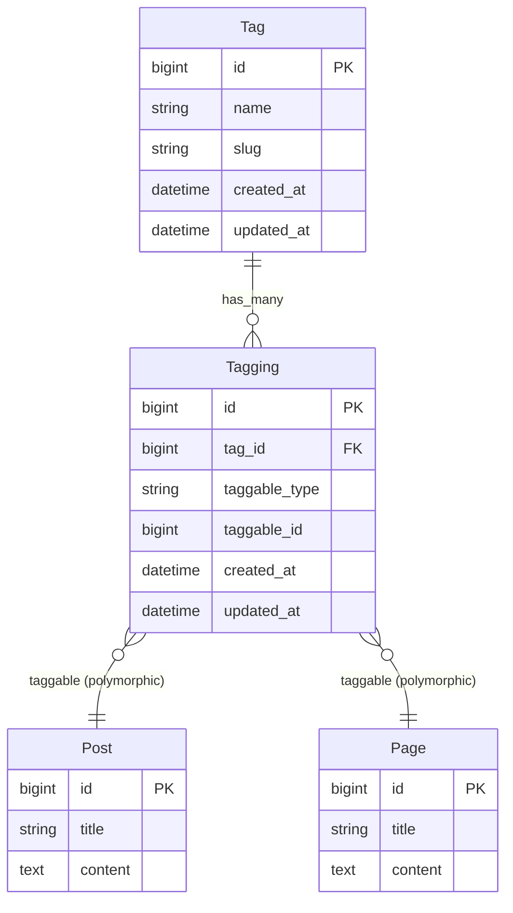

# Polymorphic Tagging System Refactor

## Overview

Refactor the existing `PostTag` join table into a polymorphic `Tagging` system so any entity (Post, Page, Media, etc.) can have tags. This is a foundational change that enables the Entity system to support tagging for all entity types.

## Problem Statement

The current tagging implementation is hardcoded to Posts:
- `railspress_post_tags` table with `post_id` and `tag_id`
- `PostTag` model with `belongs_to :post`
- Tag model has `has_many :posts, through: :post_tags`

This prevents other entities (Pages, Media) from having tags without duplicating the entire tagging infrastructure.

## Proposed Solution

Replace `post_tags` with a polymorphic `taggings` table using the industry-standard pattern (used by acts-as-taggable-on):



## Technical Approach

### Phase 1: Create New Polymorphic Infrastructure

#### 1.1 Create Taggings Migration

**File:** `db/migrate/XXXXXX_create_railspress_taggings.rb`

```ruby
class CreateRailspressTaggings < ActiveRecord::Migration[8.0]
  def change
    create_table :railspress_taggings do |t|
      t.references :tag, null: false, foreign_key: { to_table: :railspress_tags }
      t.references :taggable, polymorphic: true, null: false
      t.timestamps
    end

    # Unique constraint: one tag per taggable
    add_index :railspress_taggings,
              [:tag_id, :taggable_type, :taggable_id],
              unique: true,
              name: "index_taggings_unique"

    # For "find all entities with tag X" queries
    add_index :railspress_taggings,
              [:taggable_type, :taggable_id],
              name: "index_taggings_on_taggable"
  end
end
```

#### 1.2 Create Tagging Model

**File:** `app/models/railspress/tagging.rb`

```ruby
module Railspress
  class Tagging < ApplicationRecord
    belongs_to :tag
    belongs_to :taggable, polymorphic: true

    validates :tag_id, uniqueness: {
      scope: [:taggable_type, :taggable_id],
      message: "has already been applied to this item"
    }
  end
end
```

#### 1.3 Create Taggable Concern

**File:** `app/models/concerns/railspress/taggable.rb`

```ruby
module Railspress
  module Taggable
    extend ActiveSupport::Concern

    included do
      has_many :taggings,
               as: :taggable,
               class_name: "Railspress::Tagging",
               dependent: :destroy
      has_many :tags,
               through: :taggings,
               class_name: "Railspress::Tag"
    end

    def tag_list
      tags.pluck(:name).join(", ")
    end

    def tag_list=(csv_string)
      self.tags = Railspress::Tag.from_csv(csv_string)
    end
  end
end
```

### Phase 2: Update Existing Models

#### 2.1 Update Tag Model

**File:** `app/models/railspress/tag.rb`

```ruby
module Railspress
  class Tag < ApplicationRecord
    # New polymorphic association
    has_many :taggings, dependent: :destroy

    # Explicit reverse associations for each taggable type
    has_many :posts,
             through: :taggings,
             source: :taggable,
             source_type: "Railspress::Post"

    # REMOVE old associations:
    # has_many :post_tags, dependent: :destroy
    # has_many :posts, through: :post_tags

    # ... rest of model unchanged (validations, scopes, from_csv)
  end
end
```

#### 2.2 Update Post Model

**File:** `app/models/railspress/post.rb`

```ruby
module Railspress
  class Post < ApplicationRecord
    include Railspress::Taggable

    # REMOVE these lines:
    # has_many :post_tags, dependent: :destroy
    # has_many :tags, through: :post_tags
    #
    # def tag_list=(csv_string)
    #   self.tags = Tag.from_csv(csv_string)
    # end
    #
    # def tag_list
    #   tags.pluck(:name).join(", ")
    # end

    # ... rest of model unchanged
  end
end
```

### Phase 3: Data Migration Rake Task

**File:** `lib/tasks/railspress_tasks.rake`

```ruby
namespace :railspress do
  desc "Migrate post_tags to polymorphic taggings table"
  task migrate_tags: :environment do
    puts "Starting tag migration..."

    old_count = Railspress::PostTag.count rescue 0

    if old_count == 0
      puts "No post_tags to migrate. Done!"
      next
    end

    puts "Found #{old_count} post_tags to migrate"

    ActiveRecord::Base.transaction do
      Railspress::PostTag.find_each do |pt|
        Railspress::Tagging.find_or_create_by!(
          tag_id: pt.tag_id,
          taggable_type: "Railspress::Post",
          taggable_id: pt.post_id
        )
      end

      new_count = Railspress::Tagging.where(taggable_type: "Railspress::Post").count

      if new_count != old_count
        raise "Count mismatch! Expected #{old_count}, got #{new_count}. Rolling back."
      end

      puts "Successfully migrated #{new_count} taggings"
    end

    puts "\nMigration complete!"
    puts "You can now drop the post_tags table by running:"
    puts "  rails generate migration DropRailspressPostTags"
  end
end
```

### Phase 4: Drop Old Table

**File:** `db/migrate/XXXXXX_drop_railspress_post_tags.rb`

```ruby
class DropRailspressPostTags < ActiveRecord::Migration[8.0]
  def up
    drop_table :railspress_post_tags
  end

  def down
    create_table :railspress_post_tags do |t|
      t.references :post, null: false, foreign_key: { to_table: :railspress_posts }
      t.references :tag, null: false, foreign_key: { to_table: :railspress_tags }
      t.timestamps
    end
    add_index :railspress_post_tags, [:post_id, :tag_id], unique: true
  end
end
```

### Phase 5: Remove PostTag Model

Delete `app/models/railspress/post_tag.rb` entirely.

### Phase 6: Update Views

#### 6.1 Tags Index - Update Count Display

**File:** `app/views/railspress/admin/tags/index.html.erb`

Change `tag.posts.count` to `tag.taggings.count` (or keep `tag.posts.count` since we have the explicit association).

## Acceptance Criteria

### Functional Requirements
- [ ] New `Tagging` model with polymorphic `taggable` association
- [ ] `Taggable` concern that can be included in any model
- [ ] Post model uses `Taggable` concern (no custom tag code)
- [ ] Tag model has `has_many :posts` via explicit `source_type`
- [ ] Rake task migrates existing `post_tags` to `taggings`
- [ ] Admin tag CRUD still works
- [ ] Admin post form tag input still works
- [ ] Tag counts display correctly in admin

### Data Integrity
- [ ] Unique constraint prevents duplicate taggings
- [ ] Foreign key on `tag_id` ensures referential integrity
- [ ] Cascade delete on tag deletion removes taggings
- [ ] Cascade delete on taggable deletion removes taggings

### Tests
- [ ] `Tagging` model spec (validations, associations)
- [ ] `Taggable` concern spec (shared examples)
- [ ] `Tag` model spec (updated associations)
- [ ] `Post` model spec (uses Taggable)
- [ ] System spec for admin tag management
- [ ] System spec for post tag input

## File Changes Summary

| Action | File |
|--------|------|
| CREATE | `db/migrate/XXXXXX_create_railspress_taggings.rb` |
| CREATE | `app/models/railspress/tagging.rb` |
| CREATE | `app/models/concerns/railspress/taggable.rb` |
| CREATE | `lib/tasks/railspress_tasks.rake` |
| CREATE | `db/migrate/XXXXXX_drop_railspress_post_tags.rb` |
| MODIFY | `app/models/railspress/tag.rb` |
| MODIFY | `app/models/railspress/post.rb` |
| MODIFY | `app/views/railspress/admin/tags/index.html.erb` |
| DELETE | `app/models/railspress/post_tag.rb` |
| UPDATE | `spec/fixtures/railspress/taggings.yml` (new) |
| DELETE | `spec/fixtures/railspress/post_tags.yml` |
| CREATE | `spec/models/railspress/tagging_spec.rb` |
| CREATE | `spec/models/concerns/railspress/taggable_spec.rb` |
| MODIFY | `spec/models/railspress/tag_spec.rb` |
| MODIFY | `spec/models/railspress/post_spec.rb` |

## Implementation Order

1. Create `taggings` migration and run it
2. Create `Tagging` model
3. Create `Taggable` concern
4. Update `Tag` model (add new associations, keep old for now)
5. Update `Post` model to include `Taggable`
6. Write and run tests
7. Run rake migration task
8. Verify data migrated correctly
9. Update views (tag count display)
10. Create drop migration for `post_tags`
11. Delete `PostTag` model
12. Delete old fixtures, create new ones
13. Final test run

## Risks & Mitigations

| Risk | Mitigation |
|------|------------|
| Migration fails midway | Transaction wrapping, count verification |
| Host app references `PostTag` | Document breaking change in CHANGELOG |
| Performance regression on tag queries | Composite indexes on taggings table |
| N+1 queries when loading tags | Use `includes(:tags)` in controllers |

## Future Considerations

When adding new taggable entities (Page, Media), you'll need to:

1. Add `include Railspress::Taggable` to the model
2. Add `has_many :pages, through: :taggings, source: :taggable, source_type: "Railspress::Page"` to Tag model
3. Update fixtures if needed

## References

### Internal
- Current Tag model: `app/models/railspress/tag.rb`
- Current PostTag model: `app/models/railspress/post_tag.rb`
- Current Post model: `app/models/railspress/post.rb:35-36` (tag associations)
- Tags admin controller: `app/controllers/railspress/admin/tags_controller.rb`

### External
- [Rails Polymorphic Associations Guide](https://guides.rubyonrails.org/association_basics.html#polymorphic-associations)
- [acts-as-taggable-on schema pattern](https://github.com/mbleigh/acts-as-taggable-on/blob/master/spec/internal/db/schema.rb)
- [GitLab Polymorphic Association Guidelines](https://docs.gitlab.com/ee/development/database/polymorphic_associations.html)
